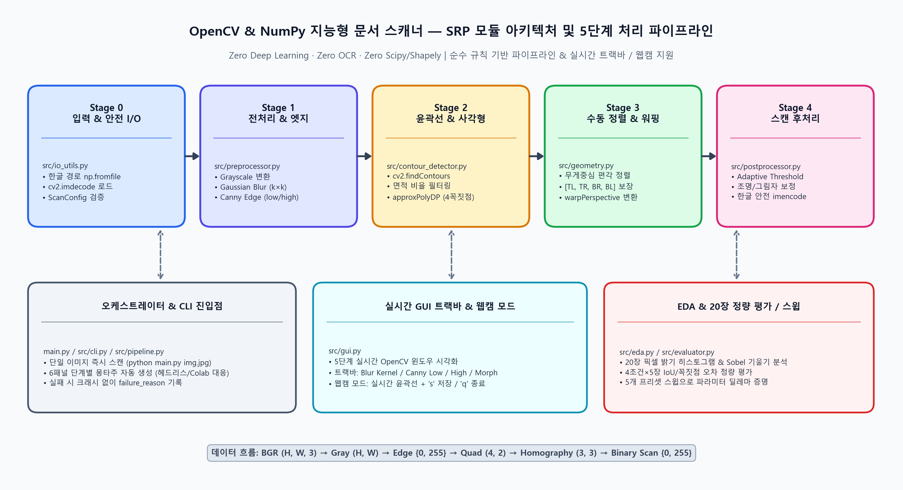
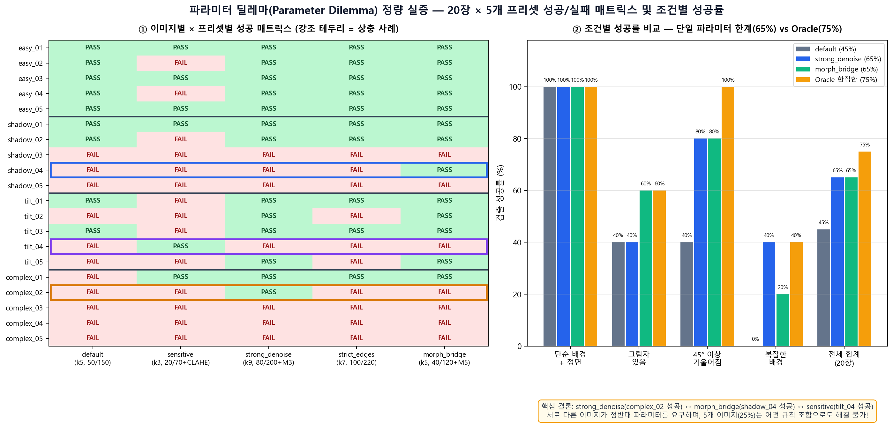
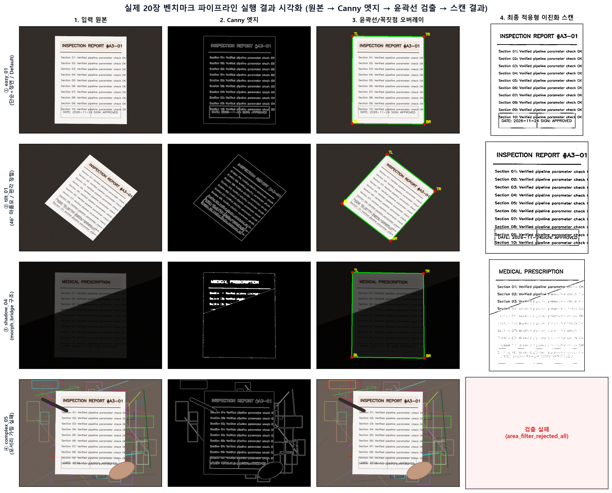

# 📄 codyssey-a3-01 — OpenCV & NumPy 기반 지능형 문서 스캐너

> **휴대폰으로 비스듬하게 촬영한 문서(영수증, A4 용지, 명함 등)를 순수 OpenCV와 NumPy의 규칙 기반 이미지 처리 파이프라인으로 자동 인식하고 반듯하게 펴주는 문서 스캐너 및 정량적 한계 분석 프로젝트**



---

## ✨ 핵심 기능

- **즉시 동작하는 문서 스캐너 CLI & GUI**: 이미지 경로만 입력하면 원본 → 전처리(Grayscale + Gaussian Blur) → Canny 엣지 → 윤곽선 검출 → 수동 4점 정렬 및 투시 변환 → 적응형 이진화 스캔본까지 자동 완성
- **실시간 트랙바 시각화 & 웹캠 모드**: `Blur Kernel`, `Canny Low/High`, `Morph Close`를 실시간 트랙바로 조절하며 5단계 창 확인, 웹캠 모드에서 `'s'` 키로 스캔 캡처 저장 / `'q'` 키로 안전 종료
- **100% 수동 기하학적 4점 좌표 정렬**: `scipy`/`shapely` 없이 무게중심 편각(`atan2`) + 사전순 타이 브레이킹으로 **45° 마름모 동률 붕괴를 완벽 방어**
- **Windows 한글 경로 안전 I/O**: `np.fromfile` + `cv2.imdecode` / `cv2.imencode` + `.tofile` 래퍼로 한글/공백 폴더에서도 100% 정상 동작
- **20장 벤치마크 EDA · 정량 평가 · 파라미터 딜레마 실증**: 4개 촬영 조건(각 5장)에 대한 밝기 히스토그램 분석 및 5개 프리셋 파라미터 스윕 자동화

---

## 📁 프로젝트 구조

```text
codyssey-a3-01/
├── main.py                              # 최상위 CLI 진입점
├── requirements.txt                     # opencv-python, numpy, matplotlib
├── PLAN.md                              # Step 1: 설계 및 실행 계획서
├── 스터디.md                              # Step 4: 과제 원문 100% 수록, 1:1 체크리스트, 주니어 해설
├── REPORT.md                            # Step 5: 미션 5대 분석 보고서 + 종합 엔지니어링 리포트
├── NOTEBOOKLM_GUIDE.md                  # Step 6: NotebookLM 업로드 목록 & 팟캐스트 가이드
├── NOTEBOOKLM_FULL_SOURCE.txt           # Step 6: 순수 프로덕션 소스코드 단일 텍스트 번들
├── study/
│   └── 핵심_코드_스터디.md                # Step 8: 핵심 코드 8선 단어분해·비유 2단 주석 학습서
├── src/                                 # SRP 기반 순수 프로덕션 소스 (2단 주석 완비)
│   ├── config.py                        # 파라미터 정규화 & 5개 실험 프리셋
│   ├── io_utils.py                      # 한글/유니코드 안전 이미지·JSON I/O & UTF-8 콘솔
│   ├── preprocessor.py                  # Grayscale, CLAHE, Gaussian Blur, Canny, Morph Close
│   ├── contour_detector.py              # findContours, 면적 필터링, approxPolyDP 4각형 탐색
│   ├── geometry.py                      # 무게중심 편각 수동 4점 정렬 + Homography 투시 변환
│   ├── postprocessor.py                 # 적응형 이진화(Adaptive Thresholding)
│   ├── pipeline.py                      # DocumentScanner 오케스트레이터 & 6패널 몽타주
│   ├── gui.py                           # 단계별 OpenCV 창, 실시간 트랙바, 웹캠 모드
│   ├── eda.py                           # 20장 픽셀 밝기 히스토그램 & Sobel 기울기 EDA
│   ├── evaluator.py                     # 20장 정량 평가(IoU/오차) & 파라미터 딜레마 스윕
│   └── cli.py                           # 서브커맨드 CLI (scan/gui/webcam/eda/evaluate/sweep)
├── scripts/
│   ├── generate_test_dataset.py         # 20장 벤치마크(4조건×5장) + metadata.json 생성
│   ├── generate_diagrams_matplotlib.py  # 고해상도 Matplotlib PNG 다이어그램 5종 생성
│   ├── verify_requirements.py           # 평가자 원클릭 시각적 검증 러너
│   └── build_notebooklm_source.py       # NOTEBOOKLM_FULL_SOURCE.txt 자동 빌더
├── tests/
│   └── test_scanner.py                  # 20개 자동화 Mock 단위 테스트 (100% PASS)
├── data/                                # 20장 테스트 이미지 & metadata.json
├── diagrams/                            # Matplotlib 고해상도 다이어그램 5종 (상대경로)
└── outputs/                             # 스캔 결과, 단계별 몽타주, EDA/평가/검증 JSON
```

---

## 🚀 설치 및 실행 가이드

### 1. 환경 설치
```bash
pip install -r requirements.txt
```
> **제약 준수**: PyTorch, TensorFlow, Keras, Tesseract OCR, `scipy`, `shapely` 등 금지 라이브러리는 일체 사용하지 않습니다.

### 2. 주요 명령어
```bash
# 1) 이미지 경로 입력 즉시 스캔 (단축 실행)
python main.py data/test_images/easy_01.jpg -o outputs/scanned_easy_01.png

# 2) 단일 이미지 스캔 + 6단계 시각화 몽타주 저장 (Colab/헤드리스 환경 권장)
python main.py scan data/test_images/easy_01.jpg -o outputs/scanned_easy_01.png --save-stages

# 3) 단계별 OpenCV 윈도우 + 실시간 Blur/Canny 트랙바 GUI 실행 (로컬 데스크톱)
python main.py gui data/test_images/shadow_04.jpg

# 4) 실시간 웹캠 문서 스캔 모드 ('s': 캡처 저장, 'q': 종료)
python main.py webcam --camera 0 --output-dir outputs/webcam

# 5) 20장 테스트셋 밝기 히스토그램 EDA & 정량 평가 & 파라미터 스윕
python main.py eda
python main.py evaluate --save-stages-dir outputs/stages
python main.py sweep
```

---

## 📈 핵심 실험 결과 미리보기





- **기본 설정 (`default`, blur=5, Canny=50/150)**: 단순 배경+정면 **100% (5/5)**, 그림자 **40% (2/5)**, 45° 이상 기울기 **40% (2/5)**, 복잡한 배경 **0% (0/5)** → 전체 **45.0% (9/20)**
- **파라미터 딜레마 실증**: 단일 최고 프리셋(`strong_denoise` / `morph_bridge`)은 **65.0% (13/20)**에서 한계에 봉착하며, 이미지별 최적 프리셋을 조합한 Oracle 합집합도 **75.0% (15/20)**입니다. 상세 분석은 [`REPORT.md`](REPORT.md)와 [`스터디.md`](스터디.md)를 참고하세요.

---

## 🧪 평가자용 원클릭 시각적 검증 가이드 (Evaluator Verification Runner)

평가자는 아래 명령어 **단 한 줄**을 복사-붙여넣기하여 금지 라이브러리 검사, 45° 수동 좌표 정렬 동률 방어, 20개 자동화 단위 테스트, 20장 EDA/정량 평가/파라미터 스윕, 마크다운 상대경로 이미지 검증, 8단계 산출물 존재 여부를 즉시 일괄 검증할 수 있습니다.

### 실행 명령어
```bash
python scripts/verify_requirements.py
```

### 예상 터미널 시각화 및 JSON 출력 공간

```text
====================================================================================
  CODYSSEY A3-01 | OPENCV DOCUMENT SCANNER - AUTOMATED REQUIREMENT VERIFIER
====================================================================================
ID       | STATUS   | REQUIREMENT CHECK
------------------------------------------------------------------------------------
REQ-01   | [PASS]   | 금지 라이브러리 미사용 (Zero DL/OCR/Scipy)
REQ-02   | [PASS]   | 수동 4점 좌표 정렬 및 45도 동률 방어
REQ-03   | [PASS]   | 자동화 Mock 단위 테스트 100% 통과
REQ-04   | [PASS]   | 20장 테스트셋 밝기 히스토그램 EDA
REQ-05   | [PASS]   | 20장 정량적 성능 평가 (4조건 × 5장)
REQ-06   | [PASS]   | 다중 프리셋 파라미터 딜레마 실증
REQ-07   | [PASS]   | 단일 이미지 E2E 스캔 + 적응형 이진화
REQ-08   | [PASS]   | Matplotlib 다이어그램 상대경로 임베딩 검증
REQ-09   | [PASS]   | 8단계 마스터 워크플로우 필수 산출물 존재
------------------------------------------------------------------------------------
  [20-IMAGE BENCHMARK SUMMARY (Default Preset: blur=5, Canny=50/150)]
  조건                     |    테스트 |   성공 |   실패 |     성공률
  ----------------------------------------------------------
  단순 배경 + 정면         |      5 |    5 |    0 |  100.0%
  그림자 있음              |      5 |    2 |    3 |   40.0%
  45도 이상 기울어짐       |      5 |    2 |    3 |   40.0%
  복잡한 배경              |      5 |    0 |    5 |    0.0%
  ----------------------------------------------------------
  전체 합계                |     20 |    9 |   11 |   45.0%
====================================================================================
  OVERALL VERIFICATION: ALL PASS (100%)
====================================================================================
```

> 전체 JSON 검증 리포트는 터미널 하단에 출력됨과 동시에 `outputs/verification_report.json` 파일로 자동 저장됩니다.
