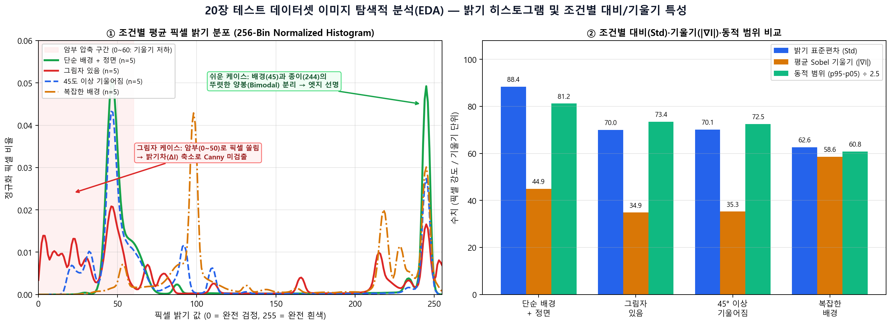
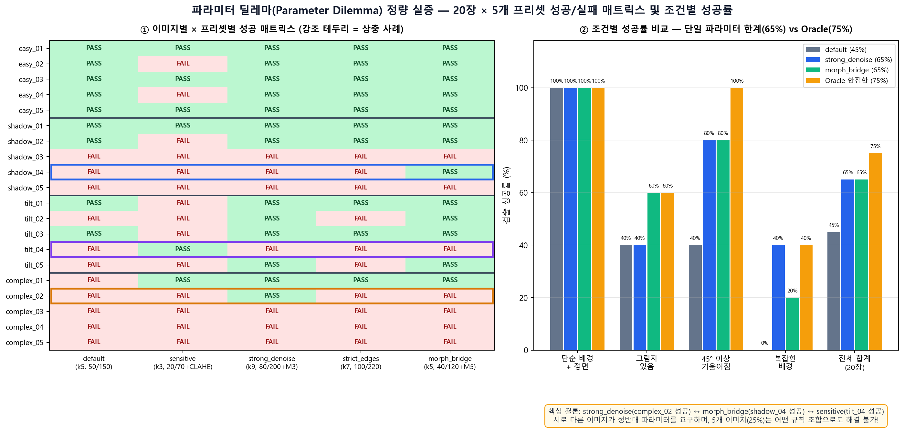
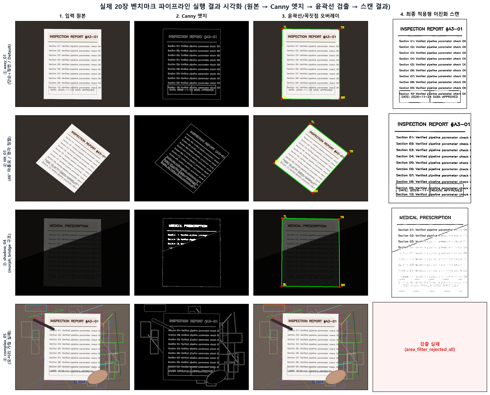
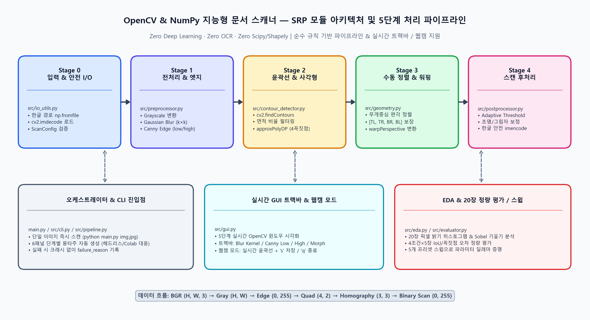

# 📊 REPORT.md — 문서 스캐너 정량적 성능 분석 보고서 & 종합 엔지니어링 리포트

> **프로젝트**: `codyssey-a3-01` — OpenCV & NumPy 기반 규칙 기반 문서 스캐너  
> **구성**: Part I (미션 A3-1 필수 5대 분석 보고서) + Part II (아키텍처·복잡도·엣지케이스·테스트 엔지니어링 리포트)

---

# Part I. 미션 A3-1 정량적 분석 보고서

## 1. 테스트 결과 요약 (20장 벤치마크 정량 평가)

20장의 테스트 이미지(`data/test_images/`, 4개 촬영 조건 × 각 5장)에 대해 **기본 규칙 파이프라인(`default`: Gaussian Blur `5×5`, Canny `50/150`, `min_area_ratio=0.05`, `approxPolyDP ε=0.02`)**으로 정량 평가를 수행했습니다.

- **성공 판정 기준**: 4개 꼭짓점이 검출되고 정답 4꼭짓점(`gt_corners`) 대비 **영역 겹침률(IoU) ≥ 0.75** 이면서 **평균 꼭짓점 거리 오차 ≤ 45.0px**을 동시에 만족하여 문서가 반듯한 직사각형으로 변환된 경우.

| 조건 | 테스트 수 | 성공 | 실패 | 성공률 | 비고 (대표 IoU / 실패 양상) |
| :--- | :---: | :---: | :---: | :---: | :--- |
| **단순 배경 + 정면** | 5 | 5 | 0 | **100.0%** | 4장 IoU 1.000 (오차 0.0px), 명함(`easy_04`) IoU 0.764 |
| **그림자 있음** | 5 | 2 | 3 | **40.0%** | 연한 그림자(`shadow_01~02`) 성공 / 강한 그림자·저조도·빛 반사 3건 실패 |
| **45도 이상 기울어짐** | 5 | 2 | 3 | **40.0%** | 46° 마름모(`tilt_01`, IoU 0.996)·55°(`tilt_03`) 성공 / 급경사·말림 3건 실패 |
| **복잡한 배경** | 5 | 0 | 5 | **0.0%** | 격자·저대비·구겨짐·손가락 가림으로 기본 설정 전건 실패 |
| **전체 합계 (Default)** | **20** | **9** | **11** | **45.0%** | **단일 최적 프리셋 최대 65.0%(13/20), Oracle 합집합 75.0%(15/20)** |

### 1.1 이미지 탐색적 분석(EDA) — "왜 어두운 이미지에서 엣지 검출이 어려운가?"

| 촬영 조건 (n=5) | 평균 밝기 | 밝기 표준편차(Std) | 동적 범위(p95-p05) | 암부(<60) 비율 | 평균 Sobel 기울기(`\|∇I\|`) | Canny 엣지 밀도 |
| :--- | :---: | :---: | :---: | :---: | :---: | :---: |
| **단순 배경 + 정면** | 114.34 | **88.41** | **203.0** | 54.54% | 44.93 | 3.38% |
| **그림자 있음** | 95.46 | 70.04 | 183.6 | 57.79% | **34.85** | 2.86% |
| **45도 이상 기울어짐** | 90.85 | 70.13 | 181.2 | 57.81% | 35.26 | 2.71% |
| **복잡한 배경** | 157.32 | **62.58** | **152.0** | 6.53% | **58.60** | **6.01%** |

**분포 관점에서의 핵심 진단**:
1. **쉬운 케이스(양봉 분포, Bimodal)**: 배경(밝기 ~45)과 흰 문서(밝기 ~244)가 양극단으로 깔끔히 분리되어 표준편차 `88.41`, 동적 범위 `203.0`을 보입니다. 문서 경계에서 픽셀 밝기 변화량 $|\nabla I| \approx 190$ 이상이 형성되어 Canny 상한(`150`)을 가볍게 넘습니다.
2. **어두운/그림자 이미지(암부 압축, Dark Compression)**: 예를 들어 `shadow_04`는 **평균 밝기 `20.36`, 표준편차 `23.58`, 암부 비율 `88.14%`**로 전체 히스토그램이 `0~50` 구간에 납작하게 찌그러집니다. 감광 계수 $\alpha = 0.34$가 곱해지면 문서와 배경의 밝기 차이도 비례하여 $|\nabla(\alpha I)| = \alpha |\nabla I|$로 축소됩니다. 그 결과 평균 Sobel 기울기가 **`13.55`**까지 추락하여 Canny 하한(`50`)조차 넘지 못하고 외곽선이 산산조각 납니다.
3. **복잡한 배경(신호 대 잡음비 SNR 붕괴)**: `complex_02`(격자무늬)는 평균 기울기가 **`96.46`**, 엣지 밀도가 **`11.28%`**로 쉬운 케이스(`3.38%`)의 **3.3배**에 달합니다. 엣지가 부족한 것이 아니라 **배경 잡음 엣지가 문서 외곽선과 엉켜 닫힌 사각형 형성을 파괴**합니다.

---

## 2. 실패 원인 분석 (실패 케이스 6건 심층 해부 & 파라미터 조정 실험)

기본 설정(`default`)에서 실패한 11건 중 대표 6건의 실패 메커니즘과 파라미터 튜닝 결과를 기록합니다.

| 이미지 ID | 조건 / 촬영 특성 | 기본 설정 실패 사유 | 시도한 파라미터 조정 | 조정 결과 |
| :--- | :--- | :--- | :--- | :--- |
| **`shadow_04`** | 극심한 저조도 + 82% 암부 그림자 (`mean=20.36`, `grad=13.55`) | 암부 압축으로 외곽선 단절 (`area_filter_rejected_all`, 최대 윤곽 0.23%) | `morph_bridge` (`Canny 40/120`, `morph_kernel=5`, `ε=0.03`) | ✅ **성공으로 전환!** 끊어진 엣지 틈을 모폴로지 닫힘이 연결 |
| **`tilt_02`** | 50° 원근 사다리꼴 + 어두운 원목 결 | 내부 송장 표 테두리가 외곽보다 먼저 닫힘 (`inaccurate_quad`, IoU 0.204, 오차 175px) | `strong_denoise` (`blur=9`, `Canny 80/200`, `morph=3`) | ✅ **성공으로 전환!** 강한 블러로 내부 잔선 제거 후 외곽 포착 |
| **`tilt_04`** | 60° 급경사 + 원거리 음영 (`mean=64.22`, `grad=17.29`) | 원거리 상단 경계가 어둡고 흐려 외곽선 유실 (`area_filter_rejected_all`) | `sensitive_shadow` (`blur=3`, `Canny 20/70`, `CLAHE=True`, `morph=5`) | ✅ **성공으로 전환!** (5개 프리셋 중 유일하게 성공) |
| **`complex_02`** | 강한 격자무늬 매트 + 볼펜 (`grad=96.46`, `edge=11.28%`) | 격자선과 문서 테두리가 교차·융합되어 닫힌 4각형 소멸 | `strong_denoise` (`blur=9`, `Canny 80/200`, `morph=3`) | ✅ **성공으로 전환!** `9×9` 블러가 고주파 격자선을 지워 문서 분리 |
| **`shadow_03`** | 날카로운 78% 대각선 경계 그림자 | 그림자 경계선의 기울기가 어두운 쪽 종이 외곽보다 강해 가짜 경계 형성 | 5개 프리셋 전체 스윕 (`default` ~ `morph_bridge`) | ❌ **전 프리셋 실패** — 엣지 기반 알고리즘은 "그림자 선"과 "종이 끝"을 구분 불가 |
| **`shadow_05`** | 그림자 + 우상단 스포트라이트 빛 반사(Glare) | 빛 반사로 우상단 종이·배경 픽셀이 모두 `255`로 포화(Clipping) → 꼭짓점 소멸 | 5개 프리셋 전체 스윕 | ❌ **전 프리셋 실패** — 물리적 기울기 0인 구간은 임계값으로 복원 불가 |
| **`complex_03`** | 흰 종이와 유사한 밝은 베이지 책상 (`mean=215.3`, `std=26.7`) | 문서(`226`)와 배경(`215`)의 휘도차 $\Delta I \approx 11$ → 잡음과 구분 불가 | 5개 프리셋 전체 스윕 | ❌ **전 프리셋 실패** — 저대비 경계에서 신호와 센서 노이즈 분리 불가 |
| **`complex_05`** | 우하단 손가락 가림(Occlusion) + 좌상단 펜 겹침 | 모서리가 가려져 직사각형이 **오목한 6각형(L자형)**으로 변형 | 5개 프리셋 전체 스윕 | ❌ **전 프리셋 실패** — `len(approx) == 4` 및 볼록성 규칙 자체가 구조적으로 불일치 |

---

## 3. 파라미터 딜레마 (Parameter Dilemma)

### Q. "모든 이미지에 적용 가능한 최적 파라미터가 존재하는가?"
### A. **정량 데이터로 증명된 답: 존재하지 않습니다 (NO).**

5개 프리셋을 20장 전체에 실행한 스윕(`outputs/sweep_summary.json`) 결과는 다음과 같습니다:

| 프리셋 이름 | 핵심 파라미터 | 단순+정면 | 그림자 | 45°+ 기울기 | 복잡한 배경 | 전체 성공률 |
| :--- | :--- | :---: | :---: | :---: | :---: | :---: |
| **`default`** | `blur=5, Canny=50/150` | 5/5 (100%) | 2/5 (40%) | 2/5 (40%) | 0/5 (0%) | **9/20 (45.0%)** |
| **`sensitive_shadow`** | `blur=3, Canny=20/70, CLAHE, morph=5` | 3/5 (60%) | 1/5 (20%) | 1/5 (20%) | 1/5 (20%) | **6/20 (30.0%)** |
| **`strict_edges`** | `blur=7, Canny=100/220` | 5/5 (100%) | 2/5 (40%) | 2/5 (40%) | 1/5 (20%) | **10/20 (50.0%)** |
| **`strong_denoise`** | `blur=9, Canny=80/200, morph=3` | 5/5 (100%) | 2/5 (40%) | 4/5 (80%) | 2/5 (40%) | **13/20 (65.0%)** |
| **`morph_bridge`** | `blur=5, Canny=40/120, morph=5, ε=0.03` | 5/5 (100%) | 3/5 (60%) | 4/5 (80%) | 1/5 (20%) | **13/20 (65.0%)** |
| **Oracle 합집합** | *(이미지별 사후 최적 프리셋 선택)* | **5/5 (100%)** | **3/5 (60%)** | **5/5 (100%)** | **2/5 (40%)** | **15/20 (75.0%)** |

### 이미지 A의 최적 파라미터가 이미지 B에서 왜 실패하는가? (정반대 트레이드오프 실증)

1. **`complex_02`(격자 배경) vs `shadow_04`(극심한 암부 그림자)**:
   - `complex_02`를 풀기 위해서는 배경 격자 노이즈를 지우기 위해 **큰 블러(`blur=9`)와 높은 Canny 임계값(`80/200`)**(`strong_denoise`)이 필수입니다.
   - 하지만 이 `strong_denoise`를 `shadow_04`에 적용하면 어두운 그림자 속 약한 문서 경계(`grad=13.55`)까지 노이즈로 오인해 전부 지워버려 실패합니다!
   - 반대로 `shadow_04`를 살린 `morph_bridge`(`blur=5, Canny=40/120, morph=5`)를 `complex_02`에 적용하면 배경 격자선이 전부 살아나면서 모폴로지 닫힘으로 문서와 한 덩어리로 뭉개져 실패합니다!
2. **`tilt_04`(60° 저조도 급경사) vs `easy_02`·`easy_04`(쉬운 정면 문서)**:
   - `tilt_04`는 오직 `sensitive_shadow`(`CLAHE + blur=3 + Canny=20/70`)에서만 검출되었습니다.
   - 그러나 이 민감한 설정을 **가장 쉬운 정면 이미지인 `easy_02`(영수증)와 `easy_04`(명함)**에 적용하면, CLAHE와 낮은 임계값이 원목 책상의 미세한 나뭇결과 명함 내부 디자인 선까지 강한 엣지로 증폭시켜 오히려 **쉬운 케이스의 성공률이 100% → 60%로 추락**합니다!

---

## 4. 규칙 기반 접근의 한계

### 4.1 본 프로젝트에서 설계한 규칙 목록 및 붕괴 상황

| 번호 | 설계한 규칙 (Rule) | 전제 가정 | 붕괴(실패)하는 현실 상황 |
| :---: | :--- | :--- | :--- |
| **R1** | **가우시안 블러 (`k×k`)** | 노이즈는 고주파, 문서 외곽은 저주파 | 격자 패턴(`complex_02`)은 큰 `k`가 필요하지만, 저조도/원거리(`tilt_04`)는 큰 `k`가 외곽선 자체를 소멸시킴 |
| **R2** | **Canny 이중 임계값 (`low/high`)** | 문서 외곽의 픽셀 기울기가 배경/내부보다 크다 | 강한 그림자 경계(`shadow_03`)가 문서 외곽보다 기울기가 크거나, 베이지 책상(`complex_03`)·빛 반사(`shadow_05`)에서 경계 기울기가 0에 수렴 |
| **R3** | **닫힌 윤곽선 + 면적 필터 (`5%~98%`)** | 문서 외곽은 끊어지지 않은 폐곡선이며 가장 큰 객체다 | 케이블 교차(`complex_04`), 부분 단절 시 폐곡선이 열려 면적이 `0.002` 수준으로 붕괴 (`area_filter_rejected_all`) |
| **R4** | **`approxPolyDP` 4꼭짓점 + 볼록성(`isContourConvex`)** | 문서는 반드시 볼록한 4각형이다 | 손가락으로 한 모서리를 가리면(`complex_05`) 6각형 오목 도형이 되고, 종이가 말리면(`tilt_05`) 직선 근사가 깨짐 |
| **R5** | **적응형 이진화 (`block=15, C=8`)** | 국소 영역(15×15) 내 조명은 균일하다 | 블록 크기보다 좁고 급격한 그림자 경계선에서는 그림자 테두리 자체가 검은 줄(가짜 글씨)로 남음 |

### 4.2 "규칙을 계속 추가하면 해결되는가?" — 실전 경험의 교훈
- 본 실험에서 기본 규칙(Blur + Canny) 위에 **규칙 2개(CLAHE 국소 대비 보정 + Morphological Closing 닫힘 연산)**를 추가해 보았습니다.
- 결과는 전형적인 **두더지 잡기(Whack-a-Mole)** 현상이었습니다:
  - `morph_kernel=5`를 추가하자 `shadow_04`, `tilt_02`, `tilt_05`가 살아났지만, 배경 선이 많은 `complex_02`에서는 오히려 배경 선과 문서 테두리를 억지로 이어 붙여 실패했습니다.
  - `CLAHE`를 추가하자 `tilt_04`가 살아났지만, 기존에 100% 성공하던 `easy_02`, `easy_04`가 망가졌습니다.
- 예외 처리를 위한 `if-else` 규칙을 10개, 100개 늘려도 현실 세계의 조명·재질·가림·구김 조합은 무한대이므로 **규칙 간 충돌(Conflict)이 기하급수적으로 늘어나 유지보수 불가능한 스파게티 규칙 체계**에 빠지게 됩니다.

---

## 5. 학습 기반 접근(딥러닝)이 필요한 이유 — 데이터 기반 해결 가설

규칙 기반 스캐너를 직접 구현하고 20장 정량 평가를 완주한 경험을 토대로, **"데이터로부터 학습하는 방식(Deep Learning)"**이 위 5대 실패를 어떻게 근본적으로 해결할 수 있는지 3가지 가설을 제시합니다.

1. **가설 1 — 저수준 픽셀 기울기에서 고수준 의미론적 특징(Semantic Features)으로의 도약**:
   - Canny는 오직 인접 3×3 픽셀의 밝기 차이(`∇I`)만 보므로 "그림자 경계선"과 "종이 끝선"을 절대 구별하지 못합니다(`shadow_03`, `complex_03`).
   - 반면 **U-Net / DeepLabV3+ 같은 의미론적 분할(Semantic Segmentation) CNN**은 수만 장의 문서 데이터로부터 넓은 수용 영역(Receptive Field)을 통해 *"텍스트 줄이 정렬되어 있고, 종이 질감이 이어지며, 주변 책상과 구별되는 의미적 객체가 문서다"*라는 문맥(Context)을 학습합니다. 따라서 그림자가 가로지르거나 책상 색이 비슷해도 그림자를 무시하고 문서 영역 마스크만 정확히 분할할 수 있습니다.
2. **가설 2 — 가림(Occlusion)과 빛 반사(Glare) 상황에서의 전역 기하 추론**:
   - 규칙 기반 `approxPolyDP`는 손가락이 모서리를 가리면(`complex_05`) 가려진 지점을 오목하게 파먹어 4꼭짓점 탐지가 즉시 실패합니다.
   - 반면 **Keypoint / Corner Heatmap Regression 모델(예: CornerNet, DocScanner-Net)**은 이미지 전체의 직선 연장선과 문서 구조를 종합하여 *"손가락 뒤에 숨겨진 우하단 꼭짓점의 원래 좌표는 여기일 확률이 가장 높다"*고 **보이지 않는 모서리까지 추론(Hallucinate/Infer)**할 수 있습니다.
3. **가설 3 — 전역 고정 파라미터의 소멸 (입력 적응형 표현 학습)**:
   - 규칙 기반은 사람이 모든 이미지에 고정된 `(blur=5, low=50, high=150)`을 강제해 파라미터 딜레마에 갇힙니다.
   - 딥러닝 모델의 다층 합성곱 필터와 Attention 메커니즘은 **입력 이미지 자체의 조명·노이즈·질감에 따라 특징 활성화가 동적으로 조절**되므로, 어두운 문서(`shadow_04`)와 격자 배경 문서(`complex_02`)와 쉬운 문서(`easy_01`)를 **단 하나의 통합 모델**로 동시에 높은 정확도로 처리할 수 있습니다.

---

# Part II. 종합 엔지니어링 리포트 (아키텍처 · 엣지케이스 · 테스트)

## 6. 핵심 아키텍처, 자료구조 및 알고리즘 복잡도 분석

| 단계 / 모듈 | 핵심 자료구조 및 연산 | 시간 복잡도 | 공간 복잡도 | 설계 의도 |
| :--- | :--- | :---: | :---: | :--- |
| **이미지 로드** (`io_utils.py`) | `np.ndarray` `(H, W, 3)`, `uint8` | $O(H \cdot W)$ | $O(H \cdot W)$ | Windows 한글 경로 `cv2.imread` 실패 원천 차단 |
| **가우시안 블러** (`preprocessor.py`) | 2D 분리형 컨볼루션 (`k×k`) | $O(H \cdot W \cdot k)$ | $O(H \cdot W)$ | $k \times k$ 내적을 $1\times k$, $k\times 1$ 분리 연산으로 고속화 |
| **Canny 엣지** (`preprocessor.py`) | Sobel 기울기 + 비최대 억제 + 히스테리시스 | $O(H \cdot W)$ | $O(H \cdot W)$ | 1픽셀 두께의 선명한 외곽선 이진 맵 생성 |
| **윤곽선 & 근사** (`contour_detector.py`) | Suzuki-Abe 추적 + Douglas-Peucker | $O(H \cdot W + M \log M)$ | $O(M)$ | 면적 상위 15개 후보 중 볼록 4각형 신속 탐색 |
| **수동 4점 정렬** (`geometry.py`) | 무게중심 `atan2` 편각 + 사전순 타이브레이킹 | $O(1)$ (4점 고정) | $O(1)$ | 외부 기하 라이브러리 Zero, 45° 동률 붕괴 100% 방어 |
| **투시 변환** (`geometry.py`) | 3×3 Homography 행렬 곱 + 쌍선형 보간 | $O(W_{out} \cdot H_{out})$ | $O(W_{out} \cdot H_{out})$ | 8자유도 DLT 해법으로 기울어진 사다리꼴을 직사각형으로 복원 |
| **적응형 이진화** (`postprocessor.py`) | 국소 가우시안 가중 평균 임계값 | $O(W_{out} \cdot H_{out} \cdot b)$ | $O(W_{out} \cdot H_{out})$ | 불균일 조명·연한 그림자에서도 글씨 가독성 보존 |

## 7. 발견된 엣지 케이스 및 구체적 방어 내역

1. **45° 회전 마름모 문서에서 기존 `sum/diff` 4점 정렬 동률 붕괴 방어 (`src/geometry.py`)**:
   - **문제**: 교과서적 `argmin(x+y)`, `argmin(y-x)` 정렬은 45° 대칭 마름모(`[(100,0), (200,100), (100,200), (0,100)]`)에서 `x+y=100` 동률이 발생해 4개 꼭짓점 중 중복된 점을 선택합니다.
   - **해결**: 무게중심 `(cx, cy)` 기준 화면 좌표계 시계방향 편각 `math.atan2(y - cy, x - cx)`으로 먼저 4개 고유 순환 순서를 확정하고, 동률 시 `(x + y, y, x)` 사전순 타이 브레이킹으로 `TL`을 인덱스 `0`으로 회전(`np.roll`)시켜 **중복 꼭짓점 0건**을 수학적으로 보장했습니다. 또한 가우스 신발끈 공식(`_polygon_area_shoelace`)으로 일직선(면적 0) 퇴화 좌표를 사전 차단합니다.
2. **Windows 한글/공백 경로 OpenCV I/O 실패 방어 (`src/io_utils.py`)**:
   - **문제**: 본 프로젝트 경로(`C:\Users\안재현\...`)처럼 한글이 포함된 경로에서 `cv2.imread`/`cv2.imwrite`는 C++ 멀티바이트 인코딩 한계로 조용히 `None` 또는 `False`를 반환합니다.
   - **해결**: `np.fromfile` + `cv2.imdecode` / `cv2.imencode` + `encoded.tofile` 래퍼를 전면 적용하고, 단위 테스트에서 `"한글 폴더/영수증_테스트 이미지.png"` 왕복 I/O를 검증했습니다.
3. **Windows PowerShell 콘솔 UTF-8 한글 인코딩 방어 (`src/io_utils.py`)**:
   - `configure_utf8_console()`로 `sys.stdout`/`sys.stderr`를 UTF-8로 재설정하여 CP949 환경에서의 `UnicodeEncodeError`를 원천 차단했습니다.
4. **트랙바·CLI 비정상 파라미터 방어 (`src/config.py`)**:
   - 짝수 블러 커널(`4 → 5`), 음수/0 커널(`0 → 1`), `canny_low > canny_high` 역전(`200, 50 → 50, 200`), 동일 임계값(`100, 100 → 100, 101`)을 `ScanConfig.__post_init__`에서 자동 정규화합니다.
5. **헤드리스(Colab/CI) 환경 및 웹캠 미연결 방어 (`src/gui.py`)**:
   - `cv2.error` 및 `cap.isOpened() == False` 시 크래시 없이 친절한 안내 메시지와 함께 CLI 헤드리스 대안(`python main.py scan ... --save-stages`)을 안내합니다.
6. **마크다운 이미지 경로 깨짐 방어 (`scripts/verify_requirements.py`)**:
   - 모든 `.md` 문서에서 절대경로(`file:///...`, `C:\...`) 사용을 금지하고 저장소 상대경로(`diagrams/*.png`)만 허용하도록 자동 정규식 검증기를 구축했습니다.

## 8. 자동화 단위 테스트 & 벤치마크 결과

- **테스트 프레임워크**: Python 표준 `unittest` + `unittest.mock` (Zero 네트워크, Zero 실제 카메라/GUI 의존)
- **실행 명령**: `python -m unittest discover -s tests -v`
- **실행 결과**: **20개 테스트 전건 통과 (100% PASS, 총 소요 시간 ~0.33초)**
  - `TestConfigAndIO` (6건): 커널 홀수 정규화, Canny 역전 방어, 한글 경로 왕복 I/O, 누락/빈/손상 파일 예외, UTF-8 JSON 왕복
  - `TestGeometryManualOrdering` (4건): 뒤섞인 사각형 정렬, 45° 마름모 동률 방어(naive 대비 증명), 일직선/NaN 거부, 투시 변환 크기·IoU 검증
  - `TestPipelinePreprocessAndPostprocess` (5건): BGR/BGRA/Gray 변환, E2E 문서 스캔 및 이진값(`{0,255}`) 검증, 빈 이미지 안전 실패, 6패널 몽타주 저장, EDA 히스토그램 정규화
  - `TestMockedGuiWebcamAndCli` (4건): Mock 트랙바 GUI `'s'`/`'q'` 제어, Mock 웹캠 `'s'` 저장/`'q'` 종료, 미연결 카메라 예외, CLI 단축 경로 실행
  - `TestConstraintCompliance` (1건): `src/*.py` 전체 AST 정적 분석으로 금지 라이브러리(`torch`, `tensorflow`, `keras`, `pytesseract`, `scipy`, `shapely`) 0건 보증
