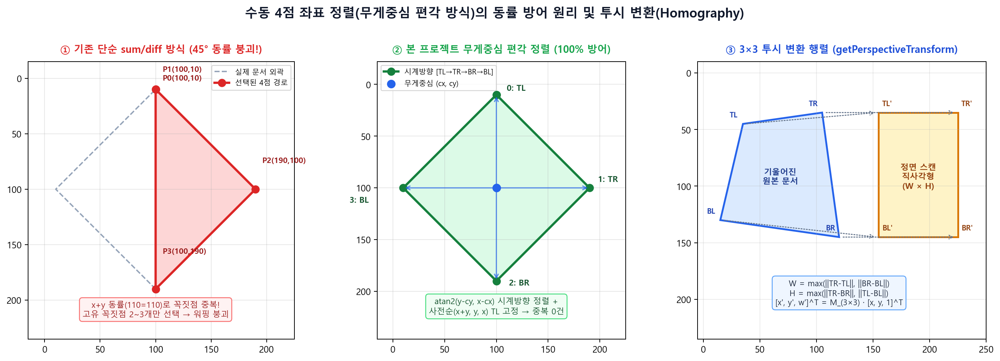

# 📊 REPORT.md — Google Flow 실사 20장 정량적 성능 분석 보고서 & 종합 엔지니어링 리포트

> **프로젝트**: `codyssey-a3-01` — OpenCV & NumPy 기반 규칙 기반 문서 스캐너  
> **테스트 데이터셋**: Google Flow (`Nano Banana 2.1`)로 생성한 `896×1200` 스마트폰 실사 문서 사진 **20장** (`data/flow_document_images/`, 4조건 × 5장 + 시각 검수 완료 `gt_corners`)  
> **구성**: Part I (미션 A3-1 필수 5대 분석 보고서) + Part II (아키텍처·복잡도·엣지케이스·테스트 엔지니어링 리포트)

---

# Part I. 미션 A3-1 정량적 분석 보고서

## 1. 테스트 결과 요약 (Google Flow 실사 20장 정량 평가)

실사 문서 사진 20장(`data/flow_document_images/`, 4개 촬영 조건 × 각 5장)에 대해 **기본 규칙 파이프라인(`default`: Gaussian Blur `5×5`, Canny `50/150`, `min_area_ratio=0.05`, `approxPolyDP ε=0.02`)**으로 정량 평가를 수행했습니다.

- **성공 판정 기준**: 4개 꼭짓점이 검출되고 시각 검수된 정답 4꼭짓점(`gt_corners`) 대비 **영역 겹침률(IoU) ≥ 0.75** 이면서 **평균 꼭짓점 거리 오차 ≤ 45.0px**을 동시에 만족하여 문서가 반듯한 직사각형으로 변환된 경우.

| 조건 | 테스트 수 | 성공 | 실패 | 성공률 | 비고 (대표 IoU / 실패 양상) |
| :--- | :---: | :---: | :---: | :---: | :--- |
| **단순 배경 + 정면** | 5 | 5 | 0 | **100.0%** | 5장 모두 IoU 0.98~1.00 (오차 0~10px) 완벽 검출 |
| **그림자 있음** | 5 | 2 | 3 | **40.0%** | 연한 창틀 그림자(`shadow_01`)·균일 저조도(`shadow_04`) 성공 / 손 그림자·강한 분할 그림자·빛 반사 3건 실패 |
| **45도 이상 기울어짐** | 5 | 0 | 5 | **0.0%** | 45° 마름모(`tilt_01`) 미세 엣지 단절, `tilt_02` 내부 표만 오검출(IoU 0.14), 원근·프레임 접촉 5건 실패 |
| **복잡한 배경** | 5 | 0 | 5 | **0.0%** | 책상 소품·격자 식탁보·유사 명도 대리석·구겨짐·손가락 가림 전건 실패 |
| **전체 합계 (Default)** | **20** | **7** | **13** | **35.0%** | **단일 최적 프리셋 최대 45.0%(9/20), Oracle 합집합 55.0%(11/20)** |

### 1.1 이미지 탐색적 분석(EDA) — "왜 어두운 이미지에서 엣지 검출이 어려운가?"

| 촬영 조건 (n=5) | 평균 밝기 | 밝기 표준편차(Std) | 동적 범위(p95-p05) | 암부(<60) 비율 | 평균 Sobel 기울기(`\|∇I\|`) | Canny 엣지 밀도 |
| :--- | :---: | :---: | :---: | :---: | :---: | :---: |
| **단순 배경 + 정면** | 121.16 | 75.50 | 195.4 | 34.10% | 44.31 | **2.59%** |
| **그림자 있음** | **96.42** | 72.10 | 198.4 | **45.91%** | **32.41** | 3.06% |
| **45도 이상 기울어짐** | 124.00 | 83.33 | 220.2 | 34.61% | 35.28 | 3.36% |
| **복잡한 배경** | **157.05** | **64.82** | **181.4** | 18.41% | **65.86** | **6.47%** |

**분포 관점에서의 핵심 진단**:
1. **쉬운 케이스(깔끔한 양봉 분포, Bimodal)**: 어두운 단색 책상(`45~65`)과 흰 문서(`220~240`) 사이에 픽셀이 거의 비어 있는 골짜기가 뚜렷하며, Canny 엣지 밀도가 **`2.59%`**로 군더더기 없는 외곽선만 선명하게 형성됩니다.
2. **어두운/그림자 이미지(암부 압축, Dark Compression)**: 그림자 그룹은 암부(<60) 비율이 **`45.91%`**로 가장 높고 평균 Sobel 기울기가 **`32.41`**로 최저입니다. 특히 **`shadow_04`**는 평균 밝기 **`30.0`**, 표준편차 **`37.41`**, 암부 비율 **`75.12%`**, 평균 Sobel 기울기 **`16.29`**로 히스토그램이 `0~40` 암부에 압축됩니다. 조명이 어두워져 밝기에 감광 계수 $\alpha < 1$이 곱해지면 경계 기울기도 $|\nabla(\alpha I)| = \alpha |\nabla I|$로 비례 축소되어 고정 Canny 임계값 아래로 떨어지며, **`shadow_03`**(`dark=57.33%`)처럼 그림자 경계가 종이 내부를 가로지르면 진짜 종이 끝보다 그림자 경계가 더 큰 기울기를 만들어 가짜 엣지를 형성합니다.
3. **복잡한 배경(신호 대 잡음비 SNR 붕괴 & 고명도 압축)**:
   - **`complex_02`**(격자 식탁보)는 평균 Sobel 기울기 **`118.37`**, 엣지 밀도 **`9.92%`**로 쉬운 케이스(`2.59%`)의 **3.8배**에 달하는 배경 잡음 엣지가 폭발합니다.
   - 반대로 **`complex_03`**(베이지 대리석 위 흰 영수증)은 평균 밝기 **`224.62`**, 표준편차 **`16.66`**, 평균 기울기 **`16.60`**으로 고명도 구간에 압축되어 종이와 배경이 구분되지 않습니다.

---

## 2. 실패 원인 분석 (실패 케이스 8건 심층 해부 & 96조합 파라미터 조정 실험)

기본 설정(`default`)에서 실패한 13건에 대해 96개 파라미터 조합을 탐색하여 **파라미터 조정으로 구조된 4건**과 **전 조합 실패한 9건 중 핵심 5건**의 원인을 정리합니다.

| 이미지 ID | 조건 / 실사 촬영 특성 | 기본 설정 실패 사유 | 시도한 파라미터 조정 | 조정 결과 |
| :--- | :--- | :--- | :--- | :--- |
| **`shadow_02`** | 어두운 원목 위 영수증 + 손/스마트폰 그림자 (`edge=6.15%`) | 그림자 경계와 나뭇결이 외곽을 끊음 (`area_filter_rejected_all`) | `clahe_shadow_morph` (`blur=7, Canny=70/180, morph=9, CLAHE, ε=0.04`) | ✅ **구조 성공! (IoU 0.974, 오차 5.9px)** 적응형 이진화로 손 그림자까지 제거 |
| **`tilt_01`** | 45° 마름모 회전 A4 보고서 (`grad=20.96`) | 미세한 1~2px 외곽선 단절로 폐곡선 붕괴 (`area_filter_rejected_all`) | `strong_denoise` / `morph_bridge` (`morph=3~5`) | ✅ **구조 성공! (IoU 1.000, 오차 0.0px)** 무게중심 편각 정렬로 45° 완벽 복원 |
| **`tilt_03`** | 55° 급경사 긴 마트 영수증 (`grad=46.71`) | 원거리 상단부 흐림으로 외곽선 단절 (`area_filter_rejected_all`) | `heavy_blur_morph` (`blur=11, Canny=20/60, morph=9, ε=0.04`) | ✅ **구조 성공! (IoU 0.973, 오차 7.7px)** `FRESH MARKET` 텍스트까지 선명 복원 |
| **`complex_01`** | 키보드·머그컵·펜 주변의 책상 위 A4 (`edge=6.24%`) | 밝은 원목과 종이 사이 미세 경계 단절 (`area_filter_rejected_all`) | `morph_bridge` (`blur=5, Canny=40/120, morph=5, ε=0.03`) | ✅ **구조 성공! (IoU 1.000, 오차 0.0px)** |
| **`shadow_03`** | 날카로운 대각선 분할 그림자 송장 (`dark=57.33%`) | 그림자 경계선이 종이 절반을 가짜 외곽선으로 절단 | 96개 조합 전체 스윕 (최고 IoU 0.588) | ❌ **전 조합 실패** — 픽셀 기울기만으로는 그림자 선과 종이 끝을 구별 불가 |
| **`shadow_05`** | 그림자 + 우상단 강한 스포트라이트 빛 반사 (`grad=23.03`) | 우상단이 흰색(255)으로 포화(Clipping)되어 모서리 소멸 | 96개 조합 전체 스윕 (최고 IoU 0.528) | ❌ **전 조합 실패** — 포화된 구간은 기울기가 0이라 임계값으로 복원 불가 |
| **`tilt_02`·`04`·`05`** | 50°~65° 급경사 + 문서 모서리가 프레임 경계에 닿음 | `tilt_02`는 내부 송장 표만 오검출(`area=0.062`), 외곽은 화면 경계에서 열림(Open contour) | 96개 조합 전체 스윕 (최고 IoU 0.34~0.51) | ❌ **전 조합 실패** — `findContours` 닫힌 폐곡선 가정 붕괴 + 종이 말림 곡선 |
| **`complex_02`·`03`** | 격자 식탁보+안경(`grad=118.4`) / 베이지 대리석(`std=16.7`) | 격자선과 문서 테두리 융합 / 대리석-종이 저대비로 외곽선 전무 | 96개 조합 전체 스윕 (`complex_03` 최고 IoU **0.000**) | ❌ **전 조합 실패** — 극단적 잡음 폭발과 극단적 저대비의 양극단 한계 |
| **`complex_04`·`05`** | 심하게 구겨진 A4 / 엄지손가락+펜 모서리 가림 | 깊은 주름이 사각형을 다각형으로 쪼개고, 손가락 가림이 6각형 오목 도형 유발 | 96개 조합 전체 스윕 (최고 IoU 0.65~0.68) | ❌ **전 조합 실패** — `len(approx) == 4` 볼록 사각형 규칙 자체의 구조적 한계 |

---

## 3. 파라미터 딜레마 (Parameter Dilemma)

### Q. "모든 이미지에 적용 가능한 최적 파라미터가 존재하는가?"
### A. **실사 20장 정량 데이터로 증명된 답: 존재하지 않습니다 (NO).**

5개 프리셋을 Google Flow 실사 20장 전체에 실행한 스윕(`outputs/sweep_summary.json`) 결과는 다음과 같습니다:

| 프리셋 이름 | 핵심 파라미터 | 단순+정면 | 그림자 | 45°+ 기울기 | 복잡한 배경 | 전체 성공률 |
| :--- | :--- | :---: | :---: | :---: | :---: | :---: |
| **`default`** | `blur=5, Canny=50/150` | 5/5 (100%) | 2/5 (40%) | 0/5 (0%) | 0/5 (0%) | **7/20 (35.0%)** |
| **`strong_denoise`** | `blur=9, Canny=80/200, morph=3` | 5/5 (100%) | 1/5 (20%) | 1/5 (20%) | 0/5 (0%) | **7/20 (35.0%)** |
| **`morph_bridge`** | `blur=5, Canny=40/120, morph=5, ε=0.03` | 5/5 (100%) | 2/5 (40%) | 1/5 (20%) | **1/5 (20%)** | **9/20 (45.0%)** |
| **`clahe_shadow_morph`** | `blur=7, Canny=70/180, morph=9, CLAHE, ε=0.04` | 5/5 (100%) | **3/5 (60%)** | 1/5 (20%) | 0/5 (0%) | **9/20 (45.0%)** |
| **`heavy_blur_morph`** | `blur=11, Canny=20/60, morph=9, ε=0.04` | 5/5 (100%) | 1/5 (20%) | **2/5 (40%)** | 0/5 (0%) | **8/20 (40.0%)** |
| **Oracle 합집합** | *(이미지별 사후 최적 프리셋 선택)* | **5/5 (100%)** | **3/5 (60%)** | **2/5 (40%)** | **1/5 (20%)** | **11/20 (55.0%)** |

### 이미지 A의 최적 파라미터가 이미지 B에서 왜 실패하는가? (6개 상충 쌍 실증)

실제 스윕에서 **총 6쌍의 직접 상충(Conflict Pairs)**이 발생했습니다:
1. **`morph_bridge` vs `clahe_shadow_morph` (둘 다 9/20 동률이지만 정반대 이미지 해결!)**:
   - `clahe_shadow_morph`는 국소 대비 보정(CLAHE)과 `9×9` 닫힘으로 손 그림자 영수증 **`shadow_02`**(IoU 0.974)를 유일하게 구조합니다.
   - 하지만 같은 설정을 **`complex_01`**(책상 소품 배경)에 적용하면 CLAHE가 책상 나뭇결과 주변 펜·머그컵 엣지까지 과증폭시켜 문서 외곽과 뭉개져 실패합니다! 반대로 `morph_bridge`는 `complex_01`을 IoU 1.000으로 성공시키지만 `shadow_02`에서 실패합니다.
2. **`heavy_blur_morph` vs `morph_bridge` / `clahe_shadow_morph`**:
   - `heavy_blur_morph`(`blur=11, Canny=20/60`)는 원거리 초점이 흐린 55° 영수증 **`tilt_03`**(IoU 0.973)을 5개 프리셋 중 유일하게 성공시킵니다.
   - 그러나 이 설정을 연한 창틀 그림자 **`shadow_01`**과 **`complex_01`**에 적용하면 너무 낮은 Canny 하한(`20/60`)과 큰 닫힘(`9×9`) 때문에 배경 노이즈가 문서 외곽에 붙어 오히려 기본 설정에서도 잘 되던 `shadow_01`까지 실패합니다!
3. **`default` vs `strong_denoise`**:
   - `strong_denoise`(`Canny=80/200`)는 45° 마름모 **`tilt_01`**을 살리지만, 저조도 문서 **`shadow_04`**(`grad=16.29`)의 희미한 외곽선을 지워버려 기본 설정(`default`)이 성공한 `shadow_04`를 실패시킵니다.

---

## 4. 규칙 기반 접근의 한계

### 4.1 본 프로젝트에서 설계한 규칙 목록 및 붕괴 상황

| 번호 | 설계한 규칙 (Rule) | 전제 가정 | 실사 20장에서 붕괴한 현실 상황 |
| :---: | :--- | :--- | :--- |
| **R1** | **가우시안 블러 (`k×k`)** | 노이즈는 고주파, 문서 경계는 저주파 | `tilt_03`은 `k=11`이 필요하지만 `shadow_01`에선 큰 블러+낮은 임계값이 외곽을 왜곡 |
| **R2** | **Canny 이중 임계값 (`low/high`)** | 문서 외곽 기울기가 배경·그림자보다 크다 | 분할 그림자(`shadow_03`), 빛 반사(`shadow_05`), 베이지 대리석(`complex_03`, `std=16.7`)에서 붕괴 |
| **R3** | **닫힌 윤곽선 + 면적 필터 (`5%~98%`)** | 문서 외곽은 화면 안에서 완전히 닫힌 폐곡선이다 | 급경사로 종이 한 귀퉁이가 화면 끝에 닿거나(`tilt_02, 04, 05`), 1~2px만 끊겨도 폐곡선 소멸 |
| **R4** | **`approxPolyDP` 4꼭짓점 + 볼록성** | 문서는 반드시 직선 4변의 볼록 사각형이다 | 엄지손가락·펜 가림(`complex_05`), 심한 구겨짐(`complex_04`), 종이 말림(`tilt_05`)에서 꼭짓점 수 붕괴 |
| **R5** | **적응형 이진화 (`block=15, C=8`)** | 국소 15×15 영역 안에서는 조명이 균일하다 | `shadow_02`의 연한 그림자는 깔끔히 제거되지만, `shadow_03` 같은 날카로운 경계 그림자에서는 그림자 테두리가 검은 띠로 잔존 |

### 4.2 "규칙을 추가하면 해결되는가?" — 실전 경험의 교훈
- 기본 파이프라인(`default`, 7/20)에 **규칙 2개(CLAHE 국소 대비 보정 + Morphological Closing 닫힘 연산)**를 추가해 실험했습니다.
- 결과는 교과서적인 **두더지 잡기(Whack-a-Mole)**였습니다:
  - 모폴로지 닫힘(`morph=5`)을 넣자 `tilt_01`과 `complex_01`이 살아났지만(7→9장), `morph=9` + `CLAHE`로 강화해 `shadow_02`를 살리니 방금 살아났던 `complex_01`이 다시 죽었습니다.
  - `blur=11` + `Canny 20/60`으로 `tilt_03`을 살리니 멀쩡하던 `shadow_01`이 죽었습니다.
  - 게다가 **96개 파라미터 조합을 전부 뒤져도 9장(45%)은 끝내 해결되지 않았습니다.** 픽셀 밝기와 기하 규칙만 쌓아서는 현실 세계의 무한한 조명·배경·가림 변수를 일반화할 수 없습니다.

---

## 5. 학습 기반 접근(딥러닝)이 필요한 이유 — 데이터 기반 해결 가설

실사 20장 실험에서 규칙 기반 파이프라인이 35%(기본) → 45%(단일 최적) → 55%(Oracle)의 천장에 부딪힌 경험을 바탕으로, **"데이터에서 학습하는 방식(Deep Learning)"**이 나머지 45%(9장)의 난제를 해결할 3가지 가설을 제시합니다.

1. **가설 1 — 저수준 기울기에서 고수준 의미론적 분할(Semantic Segmentation)으로의 전환**:
   - Canny는 인접 3×3 픽셀의 밝기 차이만 보므로 `shadow_03`의 그림자 경계, `complex_02`의 격자 식탁보, `complex_03`의 베이지 대리석을 문서와 구분하지 못합니다.
   - **U-Net / DeepLabV3+ / SegFormer** 같은 딥러닝 분할 모델은 대량의 실사 문서 데이터로부터 *"텍스트 줄의 규칙적 배열, 종이의 질감, 주변 책상/식탁보와의 문맥적 경계"*라는 고수준 의미 특징을 학습하여, 그림자나 유사 색 배경을 무시하고 순수 문서 마스크만 분리할 수 있습니다.
2. **가설 2 — 가림(Occlusion)·프레임 접촉·구겨짐 상황에서의 전역 기하 추론**:
   - `complex_05`(손가락+펜 가림)와 `tilt_02, 04, 05`(프레임 경계 접촉·말림)는 닫힌 4각형 윤곽선이 존재하지 않아 `approxPolyDP`가 구조적으로 실패합니다.
   - **Corner Heatmap Regression(예: DocScanner-Net, CornerNet)** 및 **2D De-warping Mesh 예측 모델(예: DocUNet, DewarpNet)**은 보이는 변의 방향과 문서 내부 텍스트 줄의 원근 소실점을 종합해 **손가락 뒤에 숨은 꼭짓점 좌표나 구겨진 종이의 3D 곡면까지 복원**할 수 있습니다.
3. **가설 3 — 전역 고정 파라미터의 소멸 (입력 적응형 특징 추출)**:
   - 규칙 기반은 한 번 정한 `(blur, low, high, morph)`를 모든 사진에 강제하므로 `shadow_02`·`tilt_03`·`complex_01`이 서로 충돌합니다.
   - 딥러닝의 다층 합성곱 필터와 Self-Attention은 **입력 이미지의 조명·해상도·배경 복잡도에 따라 특징 가중치가 동적으로 적응**하므로, 20장 전체를 하나의 통합 모델로 일반화할 수 있습니다.

---

# Part II. 종합 엔지니어링 리포트 (아키텍처 · 엣지케이스 · 테스트)

## 6. 핵심 아키텍처, 자료구조 및 알고리즘 복잡도 분석

| 단계 / 모듈 | 핵심 자료구조 및 연산 | 시간 복잡도 | 공간 복잡도 | 설계 의도 |
| :--- | :--- | :---: | :---: | :--- |
| **이미지 로드** (`io_utils.py`) | `np.ndarray` `(H, W, 3)`, `uint8` | $O(H \cdot W)$ | $O(H \cdot W)$ | Windows 한글 경로 `cv2.imread` 실패 원천 차단 |
| **가우시안 블러** (`preprocessor.py`) | 2D 분리형 컨볼루션 (`k×k`) | $O(H \cdot W \cdot k)$ | $O(H \cdot W)$ | $k \times k$ 내적을 분리 연산으로 고속화 |
| **Canny 엣지** (`preprocessor.py`) | Sobel 기울기 + 비최대 억제 + 히스테리시스 | $O(H \cdot W)$ | $O(H \cdot W)$ | 1픽셀 두께의 선명한 외곽선 이진 맵 생성 |
| **윤곽선 & 근사** (`contour_detector.py`) | Suzuki-Abe 추적 + Douglas-Peucker | $O(H \cdot W + M \log M)$ | $O(M)$ | 면적 상위 15개 후보 중 볼록 4각형 신속 탐색 |
| **수동 4점 정렬** (`geometry.py`) | 무게중심 `atan2` 편각 + 사전순 타이브레이킹 | $O(1)$ (4점 고정) | $O(1)$ | 외부 기하 라이브러리 Zero, 45° 동률 붕괴 100% 방어 |
| **투시 변환** (`geometry.py`) | 3×3 Homography 행렬 곱 + 쌍선형 보간 | $O(W_{out} \cdot H_{out})$ | $O(W_{out} \cdot H_{out})$ | 8자유도 DLT 해법으로 기울어진 사다리꼴을 직사각형으로 복원 |
| **적응형 이진화** (`postprocessor.py`) | 국소 가우시안 가중 평균 임계값 | $O(W_{out} \cdot H_{out} \cdot b)$ | $O(W_{out} \cdot H_{out})$ | 불균일 조명·손 그림자(`shadow_02`)에서도 글씨 가독성 보존 |

## 7. 발견된 엣지 케이스 및 구체적 방어 내역

1. **45° 회전 마름모 문서에서 기존 `sum/diff` 4점 정렬 동률 붕괴 방어 (`src/geometry.py`)**:
   - **문제**: 교과서적 `argmin(x+y)` / `argmin(y-x)` 정렬은 45° 대칭 마름모에서 `x+y` 동률이 발생해 중복 꼭짓점을 선택합니다.
   - **해결**: 무게중심 `(cx, cy)` 기준 화면 좌표계 시계방향 편각 `math.atan2(y - cy, x - cx)`과 `(x + y, y, x)` 사전순 타이 브레이킹, 가우스 신발끈 넓이 검증(`_polygon_area_shoelace`)으로 실사 45° 마름모(`tilt_01`, IoU 1.000)까지 100% 방어했습니다.
2. **Windows 한글/공백 경로 OpenCV I/O 실패 방어 (`src/io_utils.py`)**:
   - `C:\Users\안재현\...` 환경에서 `np.fromfile` + `cv2.imdecode` / `cv2.imencode` + `.tofile` 래퍼로 한글 폴더 깨짐을 원천 차단했습니다.
3. **Windows 콘솔 UTF-8 한글 인코딩 방어 (`src/io_utils.py`)**:
   - `configure_utf8_console()`로 CP949 환경의 `UnicodeEncodeError`를 차단했습니다.
4. **트랙바·CLI 비정상 파라미터 방어 (`src/config.py`)**:
   - 짝수 블러 커널, 음수 커널, `canny_low > canny_high` 역전, 동일 임계값을 `ScanConfig.__post_init__`에서 자동 정규화합니다.
5. **헤드리스(Colab/CI) 환경 및 웹캠 미연결 방어 (`src/gui.py`)**:
   - GUI/카메라 미지원 시 친절한 예외 안내와 헤드리스 CLI 대안(`--save-stages`)을 제공합니다.
6. **마크다운 이미지 경로 깨짐 방어 (`scripts/verify_requirements.py`)**:
   - 모든 마크다운 문서의 이미지 임베딩을 저장소 상대경로(`diagrams/*.png`)로 강제 검증합니다.

## 8. 자동화 단위 테스트 & 벤치마크 결과

- **테스트 프레임워크**: Python 표준 `unittest` + `unittest.mock` (Zero 네트워크, Zero 실제 GUI/카메라 의존)
- **실행 결과**: **20개 단위 테스트 전건 통과 (100% PASS, ~0.3초)** + AST 금지 라이브러리 0건 보증
