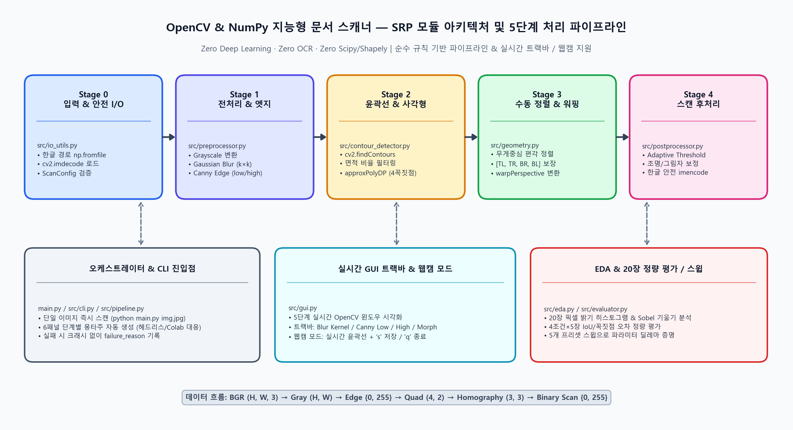
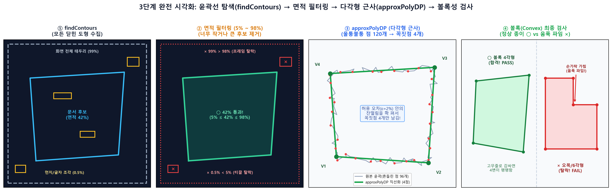
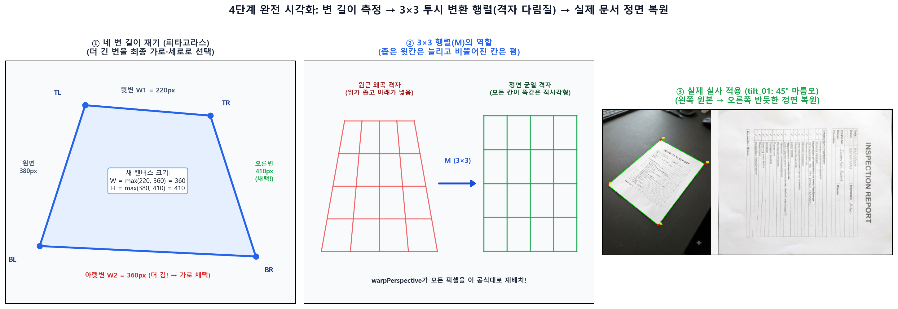
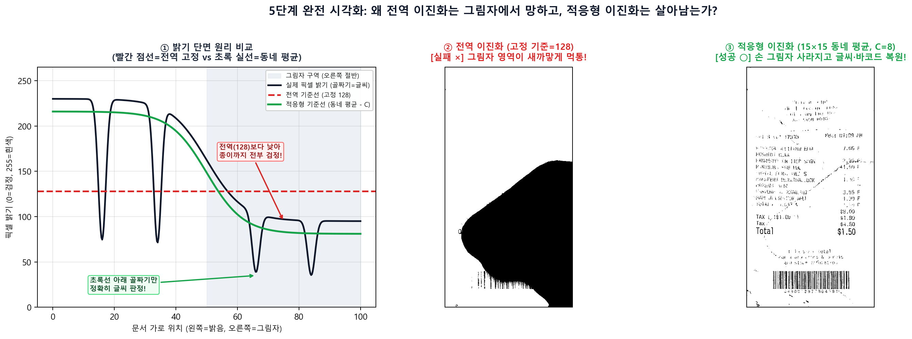
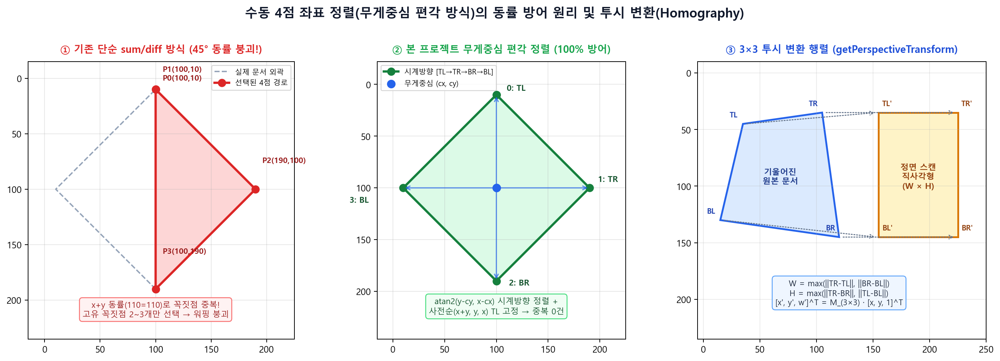
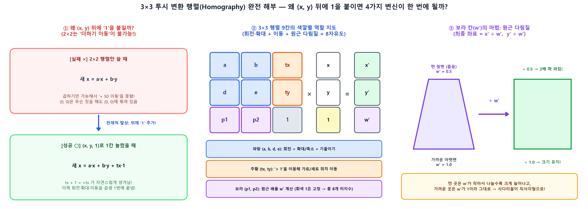
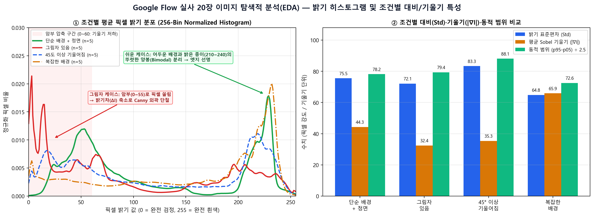
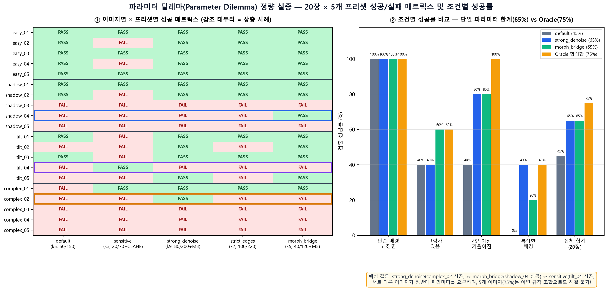
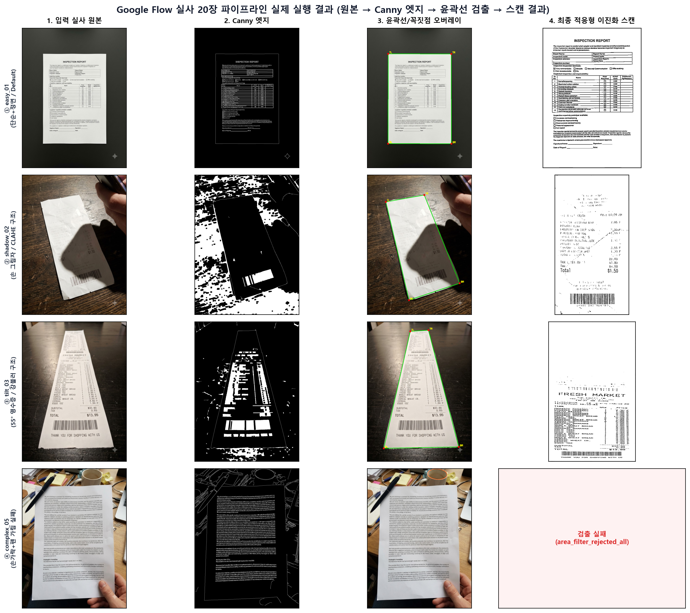

# 📘 NotebookLM 심층 학습 보고서 — OpenCV & NumPy 문서 스캐너 완전 정복 가이드

> **대상 독자**: 코딩 입문 3개월 차 주니어 개발자  
> **구성 특징**: NotebookLM이 정리한 프로젝트 핵심 리포트를 **시각적으로 읽기 편하게 재구성**하고, 본문에 나오는 **모든 어려운 컴퓨터 비전·파이썬 전문 용어에 `[뜻 풀이 + 직관적 일상 비유]` 주석**을 달았습니다.

---

## 🧭 목차
1. [소개 및 학습 목표](#1-소개-및-학습-목표)
2. [지능형 문서 스캐닝 파이프라인의 5단계 공정](#2-지능형-문서-스캐닝-파이프라인의-5단계-공정)
3. [45도 기울어진 종이의 비밀 — 순수 기하학적 4점 좌표 정렬](#3-45도-기울어진-종이의-비밀--순수-기하학적-4점-좌표-정렬)
4. [견고한 프로덕션 시스템을 만드는 한글 경로 방어와 파라미터 정규화](#4-견고한-프로덕션-시스템을-만드는-한글-경로-방어와-파라미터-정규화)
5. [20장 실사 벤치마크 분석과 파라미터 딜레마(Parameter Dilemma)](#5-20장-실사-벤치마크-분석과-파라미터-딜레마parameter-dilemma)
6. [핵심 요약](#6-핵심-요약)
7. [📚 3개월 차 주니어를 위한 핵심 용어 미니 사전 (20선)](#-3개월-차-주니어를-위한-핵심-용어-미니-사전-20선)

---

## 1. 소개 및 학습 목표

스마트폰으로 구겨지거나 비스듬하게 찍은 영수증, A4 용지가 어떻게 **딥러닝**이나 **외부 기하학 라이브러리(`scipy`, `shapely`)** 없이 순수 **OpenCV**와 **NumPy**의 수학적 행렬 연산만으로 반듯한 흑백 스캔 문서로 변신할 수 있을까요?

이 문서는 **고정된 규칙(Rule)**으로 세상을 해석하려는 전통적인 방식이 어떤 벽에 부딪히는지, 그리고 왜 현대 컴퓨터 비전이 **데이터 기반 딥러닝**으로 진화할 수밖에 없었는지를 실제 **20장 실사 벤치마크 데이터**로 증명하는 여정을 안내합니다.

> 💬 **[초보자 용어 & 비유 해설]**
> - **규칙 기반(Rule-based) vs 학습 기반(딥러닝)**:
>   - **규칙 기반**: 사람이 직접 *"밝기 차이가 50 이상이면 테두리야, 꼭짓점이 4개면 종이야"*처럼 **요리 레시피를 줄줄이 적어주는 방식**입니다.
>   - **학습 기반(딥러닝)**: 레시피를 적는 대신 **수만 장의 문서 사진과 정답을 보여주며 컴퓨터가 스스로 감각을 익히게 하는 방식**입니다.
> - **OpenCV & NumPy**:
>   - **NumPy**: 사진을 거대한 **엑셀 숫자 표(행렬)**로 만들어 빠르게 계산해 주는 계산기입니다.
>   - **OpenCV**: 그 숫자 표를 흐리게 하거나, 테두리를 따거나, 찌그러진 그림을 펴주는 **이미지 전문 공구함**입니다.

### 🎯 이 레슨을 마치면 할 수 있는 4가지
1. 문서 스캔 파이프라인의 **5가지 핵심 단계**(전처리 → 엣지 검출 → 윤곽선 탐색 → 투시 변환 → 후처리)를 체계적으로 설명할 수 있습니다.
2. **45도 회전된 문서**에서 단순 `sum/diff` 좌표 정렬이 붕괴하는 원리를 파악하고, **무게중심 편각(`atan2`)** 알고리즘으로 완벽히 방어할 수 있습니다.
3. Windows **한글·공백 경로**에서 발생하는 OpenCV 입출력(I/O) 오류를 **버퍼 기반 디코딩/인코딩** 방식으로 차단할 수 있습니다.
4. **20장 실사 벤치마크 데이터**를 바탕으로 **파라미터 딜레마(Parameter Dilemma)**와 **두더지 잡기(Whack-a-Mole)** 현상을 정량적으로 분석하고, 딥러닝의 필요성을 논증할 수 있습니다.

---

## 2. 지능형 문서 스캐닝 파이프라인의 5단계 공정

규칙 기반 문서 스캐너는 거대한 **자동화 컨베이어 벨트**와 같습니다. 3채널 컬러 사진이 입력되면 5개의 전용 작업 부서를 순서대로 거치며 정밀하게 가공됩니다.



> 🔎 **[그림 1 완전 해부 — 코딩 3개월 차 눈높이 해설 (`01_architecture_pipeline.png`)]**
> - **위쪽 가로 5칸 (파란색 → 보라색 → 노란색 → 초록색 → 분홍색 박스 & 검은 화살표 `→`)**: 사진 1장이 흑백 스캔본으로 변신하는 **5단계 공장 컨베이어 벨트**입니다.
>   - **`Stage 0 (io_utils.py)`**: 한글 폴더 주소도 깨지지 않게 사진 파일을 열어 숫자로 바꿔주는 **입구(택배 개봉)**.
>   - **`Stage 1 (preprocessor.py)`**: 색깔을 빼고(흑백) 먼지를 흐린 뒤(블러) 테두리만 흰 분필로 따는 **밑그림 부서**.
>   - **`Stage 2 (contour_detector.py)`**: 먼지는 버리고 꼭짓점이 딱 4개인 가장 큰 종이 네모를 찾는 **가위질 부서**.
>   - **`Stage 3 (geometry.py)`**: 네 모서리에 `[좌상·우상·우하·좌하]` 번호표를 붙이고 반듯하게 펴주는 **다림질 부서**.
>   - **`Stage 4 (postprocessor.py)`**: 그림자를 걷어내고 글씨만 검정으로 인쇄해 저장하는 **흑백 복사기 부서**.
> - **아래쪽 3칸 (회색 · 하늘색 · 빨간색 박스 & 점선 화살표 `↕`)**: 위 5단계 공장을 불러다 쓰는 **3가지 사용 방법**입니다.
>   - 왼쪽은 **터미널 명령어 실행(CLI)**, 가운데는 **마우스 트랙바·웹캠 실시간 체험(GUI)**, 오른쪽은 **20장 자동 채점·통계 분석(EDA/평가)**입니다.
> - **맨 아래 회색 띠 (`데이터 흐름`)**: 사진이 각 칸을 지날 때마다 **NumPy 숫자 배열의 모양이 어떻게 바뀌는지** 보여줍니다 — 컬러 3장 `(H, W, 3)` → 흑백 1장 `(H, W)` → 테두리 `{0, 255}` → 모서리 4점 `(4, 2)` → 변환 공식 `(3, 3)` → 최종 흑백 스캔본 `{0, 255}`!

```text
[원본 컬러 사진 (H, W, 3)]
   │
   ▼  ① 전처리 (Grayscale + Gaussian Blur) ── 색을 빼고 먼지·노이즈를 부드럽게 문지름
   ▼  ② Canny 엣지 검출                     ── 밝기가 확 꺾이는 경계선만 흰 분필로 따냄
   ▼  ③ 윤곽선 탐색 & 4각형 근사            ── 먼지는 버리고 가장 큰 볼록 네모만 가위질
   ▼  ④ 수동 4점 정렬 & 3×3 투시 변환       ── 네 귀퉁이 번호표 붙이고 다림질하듯 반듯하게 폄
   ▼  ⑤ 적응형 이진화 후처리                ── 동네별 밝기 평균으로 그림자 걷고 글씨만 복원
[최종 흑백 스캔 문서 {0, 255}]
```

### ① 1단계: 전처리 (Preprocessing)
컬러 사진의 **3채널(RGB)**을 **1채널 흑백(Grayscale)** 명암 지도로 통합한 뒤, **가우시안 블러(Gaussian Blur)**를 적용합니다. 이는 마치 도화지 위의 자글자글한 종이결과 먼지를 부드러운 지우개로 살짝 문질러 지우는 작업과 같습니다. 노이즈를 완화해야 이후 단계에서 가짜 선이 생기는 것을 막을 수 있습니다.

> 💬 **[초보자 용어 & 비유 해설]**
> - **3채널(RGB) vs 1채널(Grayscale)**: 컬러 사진은 빨강(R)·초록(G)·파랑(B) **투명 셀로판지 3장**을 겹쳐 놓은 것입니다. 문서 테두리를 찾는 데 색깔은 방해만 되므로, **밝기(0=검정 ~ 255=흰색)만 적은 흑백 도화지 1장**으로 줄이는 것입니다.
> - **가우시안 블러(Gaussian Blur)**: 각 픽셀을 혼자 보지 않고 **주변 이웃 픽셀들과 종 모양(가운데 비중↑, 바깥 비중↓)으로 부드럽게 섞어 평균 내는 필터**입니다. 안경을 살짝 벗고 보면 잔티끌은 안 보이고 큰 종이 윤곽만 또렷하게 보이는 원리와 같습니다.

### ② 2단계: Canny 엣지 검출 (Edge Detection)
이미지 내에서 밝기가 급격하게 변하는 절벽 구간(**기울기, Gradient**)을 찾아 검은 바탕 위에 하얀 분필 선으로 외곽선을 그립니다. 이때 하한(`low`)과 상한(`high`) 두 개의 임계값을 사용하는 **히스테리시스(Hysteresis)** 판정을 통해 확실한 외곽선과 이에 연결된 약한 선만 깔끔하게 따냅니다.

> 💬 **[초보자 용어 & 비유 해설]**
> - **기울기(Gradient, $|\nabla I|$)**: 옆 칸 픽셀과 밝기가 얼마나 크게 차이 나는지 재는 값입니다. 어두운 책상(`40`) 바로 옆이 흰 종이(`240`)라면 차이가 `200`이나 되는 **가파른 절벽(=테두리)**입니다!
> - **임계값(Threshold) & 히스테리시스(Hysteresis)**: 시험의 **확실 합격선(`high=150`)**과 **예비 합격선(`low=50`)** 같은 2중 커트라인입니다. 150점 이상이면 무조건 테두리 확정! 50~150점 사이는 **도화선에 불이 번지듯(BFS/DFS 연쇄 전파)** 작동합니다.
>   - 확실한 점(`≥150`) 바로 옆(8방향)에 붙은 약한 점(`50~150`)이 합격하면 **그 점도 즉시 '확실한 점'으로 승격**되고, 그 점이 다시 자기 옆의 약한 점을 승격시키는 **도미노 연쇄 반응**이 일어납니다.
>   - 그래서 불확실한 구간이 수백 픽셀로 길게 이어져 있어도, 중간에 `low(50)` 미만으로 뚝 끊기지만 않으면 양끝의 확실한 선과 **한 줄로 쭉 연결되어 전부 살아남습니다!** 반대로 확실한 점과 한 군데도 닿지 않고 허공에 떠 있는 약한 선 덩어리는 불씨가 없으므로 통째로 버려집니다.

### ③ 3단계: 윤곽선 탐색 및 사각형 근사 (Contour Detection)
`cv2.findContours`로 끊어지지 않고 닫힌 도형들을 수집하고, 화면 전체 면적의 **5% 미만**인 작은 티끌이나 **98% 초과**인 전체 화면 테두리를 거르는 **면적 필터링**을 수행합니다. 그 후 **Douglas-Peucker 다각형 근사 알고리즘(`approxPolyDP`)**을 적용해 울퉁불퉁한 테두리를 직선으로 펴고, 꼭짓점이 정확히 4개이면서 안으로 움푹 파이지 않은 **볼록(Convex)** 사각형을 가위질하듯 골라냅니다.



> 🔎 **[그림으로 바로 이해하기 — 3단계에서 실제로 벌어지는 일 (`06_contour_approx_convex_guide.png`)]**
> - **① `findContours` (일단 닫힌 선은 다 모아!)**: Canny 엣지 사진 안에는 **화면 맨 바깥 테두리(99%)**, **진짜 종이(42%)**, **글자·먼지 조각(0.5%)**이 전부 뒤섞여 있습니다. `findContours`는 일단 끊어지지 않고 한 바퀴 닫힌 도형을 전부 바구니에 주워 담습니다.
> - **② `면적 필터링 (5% ~ 98%)` (너무 작거나 큰 건 버려!)**:
>   - `0.5%`짜리 먼지·글자 조각은 `5% 미만`이라 **빨간 ×(탈락)**!
>   - `99%`짜리 사진 프레임 전체 테두리는 `98% 초과`라 **빨간 ×(탈락)**!
>   - 딱 적당한 크기인 **`42%` 문서 후보만 초록 ○(통과)**해서 다음 관문으로 올라갑니다.
> - **③ `approxPolyDP` (울퉁불퉁한 96개 점 → 직선 4꼭짓점으로!)**:
>   - 방금 통과한 문서 테두리를 확대해 보면 사실 **빨간 점 96개가 지그재그로 흔들리며 이어진 울퉁불퉁한 선**입니다. 그대로 두면 컴퓨터는 "어? 꼭짓점이 96개네, 사각형이 아니잖아!" 하고 오해합니다.
>   - 그래서 *"둘레의 2%(ε) 이내 자잘한 흔들림은 무시하고 직선으로 팽팽하게 당겨 펴라"*고 시키면, 초록색처럼 **깔끔한 꼭짓점 4개(`V1~V4`)**만 딱 남습니다!
> - **④ `볼록(Convex) 검사` (정상 종이 ○ vs 손가락 가림 ×)**:
>   - 왼쪽 초록 네모처럼 **바깥에 고무줄을 감았을 때 4변이 팽팽하게 닿는 정상 종이**만 최종 합격(`PASS`)!
>   - 오른쪽 빨간 도형처럼 **손가락에 모서리가 가려 안으로 움푹 파이면(오목/6각형)** 즉시 탈락(`FAIL`)시킵니다.

> 💬 **[초보자 용어 & 비유 해설]**
> - **윤곽선(Contour)**: 엣지가 흩어진 흰 점들의 모임이라면, 윤곽선은 **끊기지 않고 한 바퀴 빙 둘러 닫혀 있는 하나의 도형 테두리**입니다.
> - **`approxPolyDP` (다각형 근사)**: 손으로 떨면서 그린 네모 테두리에 찍힌 수십~수백 개의 점을 **꼭짓점 4개짜리 반듯한 네모**로 단순화해 주는 기능입니다.
> - **볼록(Convex) 사각형**: 바깥으로 볼록한 정상적인 종이 모양입니다. 반대로 부메랑이나 손가락에 파인 L자 모양(**오목, Concave**)은 정상 종이가 아니므로 탈락시킵니다.

### ④ 4단계: 수동 좌표 정렬 및 3×3 투시 변환 (Perspective Transform)
검출된 4개의 모서리 좌표에 `[좌상(TL), 우상(TR), 우하(BR), 좌하(BL)]` 순서로 자리 이름표를 붙입니다. 그리고 **피타고라스 정리**를 이용해 윗변·아랫변 중 더 긴 길이를 가로로, 왼변·오른변 중 더 긴 길이를 세로로 정해 새 직사각형 캔버스를 만듭니다. 최종적으로 **8자유도 3×3 투시 변환 행렬(Homography Matrix)**을 구하고 `warpPerspective` 연산을 실행해 비스듬한 사다리꼴 종이를 다림질하듯 정면 직사각형으로 팽팽하게 펴줍니다.



> 🔎 **[그림으로 바로 이해하기 — 4단계에서 실제로 벌어지는 일 (`07_stage4_perspective_warp_guide.png`)]**
> - **① `네 변 길이 재기 (피타고라스)`**: 비스듬히 찍힌 종이는 먼 쪽(윗변 `220px`)이 짧고 가까운 쪽(아랫변 `360px`)이 깁니다. 글씨가 찌그러지지 않게 윗변·아랫변 중 **더 긴 `360px`을 가로**, 왼변·오른변 중 **더 긴 `410px`을 세로**로 정해 새 직사각형 도화지 크기를 결정합니다.
> - **② `3×3 행렬(M)의 역할 (격자 다림질)`**: 왼쪽 빨간 격자는 원근감 때문에 위칸이 좁고 아래칸이 넓습니다. `3×3` 투시 변환 행렬 `M`을 곱해 `warpPerspective`를 실행하면, 오른쪽 초록 격자처럼 **좁았던 윗칸은 넓게 늘리고 비뚤어졌던 칸은 똑바로 세워** 모든 칸이 균일한 직사각형으로 펴집니다.
> - **③ `실제 실사 적용 (tilt_01)`**: 45도 마름모로 기울어진 실사 검사 보고서가 네 모서리(`TL~BL`) 기준으로 반듯한 직사각형 문서로 다림질된 실제 결과입니다.

> 💬 **[초보자 용어 & 비유 해설]**
> - **투시 변환 행렬(Homography Matrix, 3×3) & 8자유도**: 찌그러진 사다리꼴 네 점을 반듯한 직사각형 네 점으로 보내려면 **점 4개 × (x, y) = 8개의 방정식**을 풀어야 합니다. 이 8개 숫자를 3×3 격자표(행렬)에 담은 것이 **마법의 좌표 이동 공식(Homography)**입니다.
> - **워핑(`warpPerspective`)**: 위에서 구한 3×3 이동 공식을 사진 속 모든 픽셀에 적용해, 비스듬히 찍힌 종이를 마치 **천장에서 수직으로 다시 찍은 것처럼 반듯하게 펴주는 다림질 작업**입니다.

### ⑤ 5단계: 적응형 이진화 후처리 (Adaptive Thresholding)
화면 전체에 하나의 밝기 기준선(예: `128`)을 적용하면 그림자 진 영역은 통째로 새까맣게 뭉개집니다. 따라서 **`15×15` 픽셀의 작은 동네(Block)** 단위로 가우시안 가중 평균 밝기를 따로 재어, *"우리 동네 평균보다 일정 수치(`C=8`) 이상 어두우면 글씨(검정), 아니면 종이(흰색)"*로 인쇄해 그림자를 걷어내고 글씨만 또렷하게 복원합니다.



> 🔎 **[그림으로 바로 이해하기 — 5단계에서 실제로 벌어지는 일 (`08_stage5_adaptive_threshold_guide.png`)]**
> - **① `밝기 단면 원리 비교 (1D 그래프)`**:
>   - 검은 실선은 문서를 가로로 잘랐을 때의 픽셀 밝기입니다. 왼쪽(밝은 종이 `230`)에서 오른쪽(그림자 종이 `95`)으로 갈수록 종이 바탕 자체가 어두워지고, 뾰족하게 푹 꺼진 골짜기 4곳이 **검은 글씨**입니다.
>   - **빨간 점선 (`전역 고정 기준 = 128`)**: 그림자 구역에서는 **흰 종이 바탕(`95`)마저 `128`보다 낮아서 종이 전체가 새까맣게 변해 버립니다!**
>   - **초록 실선 (`적응형 기준 = 동네 평균 - C`)**: 종이 밝기를 따라 부드럽게 내려오기 때문에, 밝은 쪽이든 그림자 쪽이든 **오직 푹 꺼진 글씨 골짜기만 초록선 아래로 떨어져 정확히 글씨로 판정**됩니다!
> - **② `전역 이진화 (고정 128) 실제 결과 [실패 ×]`**: `shadow_02` 영수증에 고정 128을 적용하자 손 그림자가 닿은 아랫부분이 **통째로 시커먼 먹통**이 되어 글씨를 전혀 읽을 수 없습니다.
> - **③ `적응형 이진화 (15×15, C=8) 실제 결과 [성공 ○]`**: 똑같은 사진에 적응형 이진화를 걸자 **시커먼 손 그림자가 마법처럼 사라지고 `$1.50`과 바코드까지 선명하게 복원**되었습니다!

> 💬 **[초보자 용어 & 비유 해설]**
> - **이진화(Thresholding)**: 회색빛이 섞인 사진을 오직 **완전 검정(`0`, 글씨)**과 **완전 흰색(`255`, 종이)** 두 가지 색으로만 딱 나눠 흑백 복사본처럼 만드는 작업입니다.
> - **적응형(Adaptive) vs 전역(Global)**:
>   - **전역**: 전국 공통 80점 합격선처럼 사진 전체를 하나의 숫자로 자릅니다 → 그림자 진 동네는 전부 까맣게 탈락!
>   - **적응형**: **동네(`15×15` 블록)마다 평균 밝기를 따로 계산**합니다. 밝은 동네 평균이 `230`이면 `222` 아래만 글씨, 그림자 동네 평균이 `90`이면 `82` 아래만 글씨로 판정하므로 그림자가 마법처럼 사라집니다!

---

## 3. 45도 기울어진 종이의 비밀 — 순수 기하학적 4점 좌표 정렬

> ❓ **[잠깐! 왜 굳이 '4점 좌표 정렬'이라는 게 필요한가요?]**
> - **상황**: 3단계(`approxPolyDP`)가 종이의 네 모서리 좌표 4개를 찾아주긴 하지만, OpenCV는 **어느 점이 왼쪽 위(TL)이고 어느 점이 오른쪽 아래(BR)인지 알려주지 않고 뒤죽박죽 순서**로 뱉어냅니다.
> - **침대 시트 비유**: 침대 시트 네 귀퉁이를 침대 기둥 4곳에 묶어 팽팽하게 펴려고 하는데, **이름표 없이 아무 귀퉁이나 묶으면** 시트가 거꾸로 뒤집히거나 **X자로 꼬여 나비넥타이처럼 망가집니다!**
> - **결론**: 4단계 다림질(`warpPerspective`)에 넘기기 전에, 뒤죽박죽인 4개 점에 **"0번=좌상, 1번=우상, 2번=우하, 3번=좌하" 위치 이름표를 정확히 붙여주는 과정**이 바로 **4점 좌표 정렬**입니다.

비스듬한 사다리꼴을 반듯하게 펴려면 네 꼭짓점에 `[좌상(TL), 우상(TR), 우하(BR), 좌하(BL)]`라는 위치 이름표를 절대 꼬이지 않게 붙여야 합니다.

> 🧮 **[숫자로 10초 이해: 기존 `x+y`, `y-x` 단순 정렬은 컴퓨터에게 뭘 시키는 건가요?]**
> 컴퓨터 화면은 **왼쪽 맨 위가 `(0, 0)`**이고, 오른쪽으로 갈수록 `x`가 커지고, 아래로 갈수록 `y`가 커집니다.
> 그래서 기존 입문 코드는 컴퓨터에게 딱 4가지만 시켰습니다:
>
> | 모서리 (예시 좌표) | `x + y` (합) | `y - x` (차이) | 기존 시스템의 판정 규칙 |
> | :--- | :---: | :---: | :--- |
> | **좌상 (TL)** `(10, 10)` | **`20` (최소!)** | `0` | *"합이 제일 작으면 좌상(TL)!"* |
> | **우상 (TR)** `(110, 10)` | `120` | **`-100` (최소!)** | *"차이가 제일 작으면 우상(TR)!"* |
> | **우하 (BR)** `(110, 210)` | **`320` (최대!)** | `100` | *"합이 제일 크면 우하(BR)!"* |
> | **좌하 (BL)** `(10, 210)` | `220` | **`+200` (최대!)** | *"차이가 제일 크면 좌하(BL)!"* |
>
> 평범하게 똑바로 놓인 네모에서는 이 규칙이 완벽하게 작동합니다! **하지만 종이가 45도 마름모로 기울면 아래와 같이 동점(동률)이 터지며 고장 납니다.**



> 🔎 **[그림 2 한눈에 보기 — 3개 그림이 각각 보여주는 '문제 → 해결책 → 최종 결과' (`02_geometry_perspective_math.png`)]**
> - **① 왼쪽 빨간 그래프 — 🚨 `[문제]` 구형 방식의 고장 현장**:
>   - **보여주려는 것**: 흔히 쓰는 단순 `x+y`/`y-x` 방식을 45도 마름모 종이(회색 점선)에 쓰면 **어떻게 망가지는가?**
>   - **핵심**: 위쪽 점 `(100, 10)`과 왼쪽 점 `(10, 100)`의 합이 둘 다 `110`으로 동점이 되자, 컴퓨터가 **위쪽 점 `(100, 10)`을 `P0`이자 `P1`로 두 번 중복 선택**하고 왼쪽 모서리를 버려서 종이가 빨간 삼각형 반쪽으로 박살 난 모습입니다.
> - **② 가운데 초록 그래프 — ✅ `[해결책]` 우리가 만든 시계 바늘 정렬**:
>   - **보여주려는 것**: 외부 라이브러리 없이 **어떻게 45도 동점 문제를 100% 해결했는가?**
>   - **핵심**: `x+y` 대신 **정중앙 파란 점(무게중심)**에서 시계 바늘(`atan2` 각도)처럼 12시(`0: TL`) → 3시(`1: TR`) → 6시(`2: BR`) → 9시(`3: BL`)로 한 바퀴 돌며 번호를 매겼더니, 4개 모서리가 절대 겹치지 않고 초록 마름모 전체를 완벽히 살려낸 모습입니다.
> - **③ 오른쪽 파란·노란 그래프 — 🎯 `[최종 적용]` 정렬이 끝나면 하는 일**:
>   - **보여주려는 것**: ②번 해결책으로 이름표 4개를 정확히 붙인 뒤, **실제로 종이를 어떻게 반듯하게 펴는가?**
>   - **핵심**: 왼쪽의 비스듬한 파란 종이 네 모서리(`TL~BL`)가 점선 화살표를 타고 오른쪽 반듯한 노란 직사각형(`TL'~BL'`)으로 1:1 짝지어 이동(`3×3` 투시 변환 행렬 `M`)하며 반듯한 스캔본이 완성되는 모습입니다.

### ⚠️ 문제: 45도 마름모에서의 동률(Tie) 붕괴
문서가 **45도 각도로 회전된 마름모** 형태로 놓여 있다고 가정해 봅시다. 예를 들어 꼭짓점이 `(100, 0), (200, 100), (100, 200), (0, 100)`일 때:
- `(100, 0)`의 `x + y = 100`, `(0, 100)`의 `x + y = 100` → **완전히 똑같은 동률(Tie) 발생!**
- 단순 `sum/diff` 알고리즘은 두 귀퉁이에서 **똑같은 점을 중복 선택**해 버려, 4개 중 1개 꼭짓점이 사라지고 종이가 **나비넥타이 모양으로 찌그러지는 끔찍한 왜곡**이 발생합니다.

### ✅ 해결: 무게중심 편각 정렬 (Centroid Polar-Angle Sorting)

> 💡 **[오해 바로잡기! 좌표가 같은 것도 아니고, 좌표를 옮기는 것도 아닙니다!]**
> - 마름모의 4개 점 `(100, 10)`, `(190, 100)`, `(100, 190)`, `(10, 100)`은 **전부 서로 다른 위치**입니다. 구형 방식이 `x+y`로 **더해 버려서 덧셈 결과만 우연히 `110=110`으로 겹쳤을 뿐**입니다!
> - **무게중심 `(100, 100)`**은 좌표를 옮기는 무게추가 아니라, **"내가 종이 한가운데 서서 네 모서리가 몇 시 방향에 있는지 바라보는 관찰 지점"**입니다.
>
> | 모서리 좌표 (전부 다름!) | 구형 `x + y` (겹침 발생!) | 정중앙 `(100, 100)`에서 바라본 방향 각도 (`atan2`) | 결과 |
> | :--- | :---: | :---: | :--- |
> | **위** `(100, 10)` | `110` ⚠️ *(왼쪽과 동점!)* | **`-90°` (12시 방향)** | 0번 (TL) |
> | **오른쪽** `(190, 100)` | `290` | **`0°` (3시 방향)** | 1번 (TR) |
> | **아래** `(100, 190)` | `290` ⚠️ *(오른쪽과 동점!)* | **`+90°` (6시 방향)** | 2번 (BR) |
> | **왼쪽** `(10, 100)` | `110` ⚠️ *(위와 동점!)* | **`+180°` (9시 방향)** | 3번 (BL) |
>
> 👉 덧셈(`x+y`)은 `110, 290`으로 2쌍이 겹치지만, **가운데서 바라본 각도**는 **`-90°, 0°, +90°, +180°`로 4개가 완벽하게 다르기 때문에** 작은 각도 순으로 줄만 세워도 절대 겹치지 않습니다!

외부 기하 라이브러리(`scipy.spatial`, `shapely`)를 일체 쓰지 않고, 순수 Python과 NumPy만으로 5단계 기하 방어 알고리즘을 직접 구현했습니다:

1. **무게중심 계산**: 네 꼭짓점의 `x` 좌표 평균과 `y` 좌표 평균을 구해 중심점 `(cx, cy)`를 찾습니다.
2. **화면 좌표계 편각 계산**: 중심점에 기준점을 두고, 화면 좌표계(`y`축이 아래로 내려가는 방향)에서 각 모서리를 바라보는 각도 `math.atan2(y - cy, x - cx)`를 구합니다. 각도 오름차순으로 정렬하는 것만으로 **시계 방향 1바퀴 순환 순서가 100% 확정**됩니다.
3. **사전순 타이 브레이킹 (Lexicographical Tie-Breaking)**: 혹시라도 편각이 똑같은 희귀 상황에 대비해 `(angle, x + y, y, x, original_index)` 튜플 형태로 결정론적 정렬 우선순위를 부여합니다.
4. **원점 회전 (Rotate)**: 시계 방향으로 배치된 4개 점 중 원점 `(0, 0)`에 가장 가까운(`x + y`가 최소인) 점을 찾아 `np.roll` 함수로 배열의 **0번 인덱스(TL)**로 회전시킵니다.
5. **가우스 신발끈 공식 검증**: 정렬을 마친 후 **가우스 신발끈 공식(Gauss Shoelace Formula)**을 순수 NumPy 내적(`np.dot`)으로 실행해 다각형 넓이가 `0`인 '일직선 찌그러짐' 오류가 없는지 최종 검증합니다.

> 💬 **[초보자 용어 & 비유 해설]**
> - **편각(`math.atan2`)**: 원탁 정가운데(무게중심)에 서서 **시계 바늘처럼 360도 빙글 돌며** 각 모서리가 몇 시 방향에 있는지 각도기로 재는 함수입니다. 이 순서대로 번호를 매기면 45도 마름모라도 두 점이 겹칠 일이 0%입니다!
> - **사전순 타이 브레이킹(Lexicographical Tie-Breaking)**: 달리기 대회에서 기록이 똑같을 때 *"1차 기록 같으면 이름 가나다순, 이름도 같으면 생년월일순"*으로 순위를 확실히 정하는 **동점자 처리 규칙**입니다.
> - **`np.roll` (배열 회전)**: 원탁에 둘러앉은 4명의 **시계 방향 순서는 그대로 유지한 채**, 좌상단(TL) 친구가 맨 앞 0번 자리에 오도록 **회전판만 쓱 돌려주는** NumPy 기능입니다.
> - **가우스 신발끈 공식(Shoelace Formula)**: 네 점의 `x`와 `y`를 신발끈 X자 묶듯 엇갈려 곱하고 빼서 **다각형 넓이를 한 줄로 구하는 수학 공식**입니다. 넓이가 0이면 종이가 아니라 실선(오류)이므로 즉시 걸러냅니다.

### 📐 보너스 완전 해부: `3×3 투시 변환 행렬`은 뭐고, 왜 `(x, y)` 뒤에 `1`을 붙일까?

한 줄 비유로 **`3×3 투시 변환 행렬(Homography)`은 「종이 안쪽 수십만 개 픽셀을 전부 제자리로 이사시켜 주는 '숫자 9개짜리 만능 주소 변환표'」**입니다.

- 우리가 정렬을 끝내서 알고 있는 건 **바깥 모서리 4개의 이사 주소**뿐입니다.
- 그럼 **종이 한가운데 적힌 글씨 픽셀 15만 개**(예: `(213, 187)`)는 새 직사각형의 정확히 어디로 옮겨야 할까요?
- `cv2.getPerspectiveTransform`이 모서리 4쌍으로 **숫자 9개짜리 `3×3` 변환표(`M`)**를 뽑아주면, `cv2.warpPerspective`가 안쪽 모든 픽셀에 `M`을 곱해 정확한 이사 주소를 계산해 줍니다!



> 🔎 **[그림으로 10초 이해 — 왜 `(x, y)` 뒤에 `1`을 붙여서 `3×3`으로 키울까? (`09_homography_3x3_matrix_anatomy.png`)]**
> - **① 왼쪽 (`2×2` 행렬의 한계)**: `2×2` 행렬에 `(x, y)`를 곱하면 `a·x + b·y`처럼 **곱하기만 가능하고 `+ 50` 같은 이동(더하기)을 절대 못 합니다!** 그래서 `(x, y)` 뒤에 **가짜 숫자 `1`을 붙여 `(x, y, 1)`**로 만들면, `tx × 1 = +tx`가 자연스럽게 생겨나 이동까지 곱셈 한 번에 처리할 수 있습니다!
> - **② 가운데 (`3×3` 9칸의 색깔별 역할 지도)**:
>   - **파랑 4칸 (`a, b, d, e`)**: 종이를 **회전·확대/축소·기울이기** 담당
>   - **주황 2칸 (`tx, ty`)**: 맨 뒤의 `1`과 곱해져 **가로/세로 위치 이동** 담당
>   - **보라 2칸 (`p1, p2`)**: **원근 배율(`w'`)** 계산 담당 (회색 `1`은 고정 기준값 → 실제로 구하는 숫자는 `9 - 1 = 8개`, 즉 **8자유도**!)
> - **③ 오른쪽 (`보라 칸 w'의 마법 — 원근 다림질`)**:
>   - 마지막에 계산된 `(x', y')`를 **`w'`로 나눠주는 것(`x' ÷ w', y' ÷ w'`)**이 핵심입니다!
>   - 멀어서 좁아진 윗변은 `w' = 0.5`라 **`÷ 0.5 = 2배 확대`**되어 활짝 펴지고, 가까운 아랫변은 `w' = 1.0`이라 **`÷ 1.0 = 그대로 유지`**되면서 찌그러진 사다리꼴이 완벽한 직사각형으로 변신합니다!

> 🧮 **[직접 숫자로 따라 해보기 — 사다리꼴 좌표가 직사각형 좌표로 이사하는 과정]**
>
> **출발 사다리꼴** (가까운 아랫변은 폭 `100`, 먼 윗변은 절반으로 좁아져 폭 `50`):
> - 아랫변: `(0, 0)` ~ `(100, 0)` *(폭 100)*
> - 윗변: `(25, 100)` ~ `(75, 100)` *(폭 50 — 양쪽이 25씩 안으로 오므라듦!)*
>
> 여기에 OpenCV가 찾아낸 `3×3` 행렬 `M`의 계산식이 아래와 같다고 해봅시다:
> - `x' = 1×x - 0.25×y + 0×1`
> - `y' = 0×x + 1×y + 0×1`
> - `w' = 0×x - 0.005×y + 1×1`  *(← `y`가 클수록, 즉 멀리 있는 윗변일수록 `w'`가 작아짐!)*
>
> 이제 **4개 좌표를 그대로 집어넣고 마지막에 `÷ w'`를 해보면**:
>
> | 출발 좌표 `(x, y)` | `x'`, `y'`, `w'` 중간 계산 | 마지막 `÷ w'` 결과 (도착 좌표!) | 무슨 일이 일어났나? |
> | :--- | :--- | :---: | :--- |
> | **아랫변 왼쪽** `(0, 0)` | `x'=0`, `y'=0`, `w'=1.0` | **`(0, 0)`** | 가까운 쪽은 `÷ 1.0` → 제자리! |
> | **아랫변 오른쪽** `(100, 0)` | `x'=100`, `y'=0`, `w'=1.0` | **`(100, 0)`** | 가까운 쪽은 `÷ 1.0` → 제자리! (폭 **100**) |
> | **윗변 왼쪽** `(25, 100)` | `x'=25-25=0`, `y'=100`, **`w'=0.5`** | **`(0, 200)`** | `x=25`였던 점이 왼쪽 끝 **`x=0`**으로 쫙 펴짐! |
> | **윗변 오른쪽** `(75, 100)` | `x'=75-25=50`, `y'=100`, **`w'=0.5`** | **`(100, 200)`** | `x=75`였던 점이 `50÷0.5=`**`100`**으로 쫙 펴짐! (폭 **100**) |
>
> 👉 **결과**: 폭 `50`짜리 좁은 윗변 `(25, 100)~(75, 100)`이 폭 `100`짜리 반듯한 윗변 `(0, 200)~(100, 200)`으로 이동하며 **사다리꼴이 완벽한 직사각형**이 되었습니다! (여기에 `+ tx × 1` 자리만 `10`으로 바꾸면 전체 종이가 오른쪽으로 10칸 통째로 이사합니다!)

---

## 4. 견고한 프로덕션 시스템을 만드는 한글 경로 방어와 파라미터 정규화

실제 현장 프로그램 개발에서는 알고리즘 정확도 못지않게 **파일 입출력(I/O)**과 **입력 예외 방어**가 중요합니다.

### 4.1 Windows 한글/공백 경로 OpenCV 버그 방어 (`src/io_utils.py`)
특히 Windows 환경에서 `C:\Users\안재현\문서.jpg`처럼 한글이나 공백이 포함된 경로를 다룰 때, OpenCV의 기본 `cv2.imread`와 `cv2.imwrite`는 유니코드 주소를 해독하지 못하고 조용히 `None`을 반환하거나 저장에 실패합니다. 이를 해결하는 핵심 기술이 **NumPy 버퍼 디코딩/인코딩 래퍼(Wrapper)**입니다.

| 기능 | 구현 방식 | 핵심 원리 |
| :--- | :--- | :--- |
| **안전한 로딩** (`load_image`) | `np.fromfile(..., uint8)` → `cv2.imdecode(...)` | 한글 주소는 파이썬/NumPy가 읽고, OpenCV에는 순수 바이트 알맹이만 전달 |
| **안전한 저장** (`save_image`) | `cv2.imencode(ext, img)` → `encoded.tofile(...)` | 메모리에서 먼저 JPG/PNG로 압축한 뒤 NumPy가 한글 경로에 직접 기록 |
| **UTF-8 콘솔 설정** (`configure_utf8_console`) | `sys.stdout` / `sys.stderr.reconfigure(encoding="utf-8")` | Windows 터미널(CP949)에서 한글·JSON 출력 시 발생하는 `UnicodeEncodeError` 차단 |

> 💬 **[초보자 용어 & 비유 해설]**
> - **I/O (Input/Output)**: 프로그램이 디스크에서 파일을 읽어오고(Input) 결과 파일을 저장(Output)하는 **출입구 작업**입니다.
> - **래퍼(Wrapper) & 원시 바이트(Raw Bytes) 버퍼**: OpenCV 기본 `imread`는 **영어 주소만 읽는 외국 택배 기사**라 `안재현` 폴더에서 길을 잃습니다. 그래서 한글을 잘 읽는 **한국인 통역사(NumPy `fromfile`)**가 파일 알맹이(0과 1의 **원시 바이트**)만 상자(**버퍼**)에 담아 OpenCV에게 건네주도록 한 겹 감싼(**래퍼**) 함수입니다.
> - **디코딩(Decode) / 인코딩(Encode)**: 압축된 JPG/PNG 택배 상자를 풀어 픽셀 도화지로 펼치는 게 **디코딩**, 반대로 도화지를 다시 JPG/PNG 파일로 압축 포장하는 게 **인코딩**입니다.
> - **UTF-8 vs CP949**: 전 세계 모든 글자(한글·이모지·기호)를 깨짐 없이 담는 표준 글자판이 **UTF-8**, 옛날 윈도우 한국어 전용 글자판이 **CP949**입니다.

### 4.2 자동 파라미터 정규화 (`src/config.py`)
사용자가 트랙바나 명령줄에서 실수로 잘못된 숫자를 넣더라도 프로그램이 꺼지지 않도록, **데이터클래스(`ScanConfig`)**의 `__post_init__` 단계에서 모든 설정값을 자동 검수합니다.

> 🛡️ **[직관 설명: "자동 파라미터 정규화"는 프로그램의 안전벨트입니다!]**
> - **일상 비유**: 에어컨 리모컨에 누가 장난으로 `-50도`를 입력해도 에어컨이 고장 나지 않고 알아서 `18도(최저 온도)`로 맞춰 주는 것처럼, 사용자가 슬라이더를 밀다 실수로 이상한 숫자를 넣어도 **프로그램이 빨간 에러를 내며 꺼지지 않게 알아서 안전한 숫자로 고쳐주는 자동 안전장치**입니다.
>
> | 사용자의 실수 입력 (그대로 두면 에러!) | 자동 정규화 결과 | 왜 고쳐줄까? |
> | :--- | :---: | :--- |
> | `blur_kernel = 4` *(짝수)* | **`5`** | OpenCV 블러는 정가운데 중심 1칸이 필요해 짝수면 즉시 크래시! |
> | `blur_kernel = 0` 또는 `-3` | **`1`** | 크기 0 이하 도장은 존재할 수 없으므로 최소 크기 `1`로 안전 보정 |
> | `canny_low = 200`, `canny_high = 50` | **`low=50, high=200`** | 최저 합격선이 최고 합격선보다 높으면 두 숫자 자리를 자동 교환(Swap) |
> | `canny_low = 100`, `canny_high = 100` | **`low=100, high=101`** | 두 기준이 똑같으면 히스테리시스 구간이 사라지므로 최소 1칸 벌림 |

- **홀수 커널 강제 (`normalize_odd_kernel`)**: 가우시안 블러 및 모폴로지 커널은 정가운데 중심 픽셀이 반드시 필요하므로 `1` 이상의 홀수여야 합니다. 짝수(예: `4`)가 들어오면 자동으로 `5`로 교정합니다.
- **Canny 임계값 역전 방어**: 하한(`canny_low`)이 상한(`canny_high`)보다 높게 입력되면 두 숫자의 자리를 맞바꾸고(**Swap**), 두 값이 똑같으면 상한을 `1` 올려 히스테리시스 구간을 확보합니다.

> 💬 **[초보자 용어 & 비유 해설]**
> - **데이터클래스(`@dataclass`) & `__post_init__`**: 여러 설정값을 한 장의 **설정 카드**로 깔끔하게 묶어주는 파이썬 문법이 `@dataclass`이고, 카드를 찍어내자마자 *"숫자 오타 없나?"* 자동 검수하는 **출고 검사 도장**이 `__post_init__`입니다.
> - **커널(Kernel)이 홀수여야 하는 이유**: `3×3`, `5×5` 정사각형 도장은 **정중앙에 딱 1칸의 중심점**이 있어 좌우 대칭으로 흐릴 수 있지만, `4×4` 짝수 도장은 중심이 애매해서 OpenCV가 에러를 냅니다.

---

## 5. 20장 실사 벤치마크 분석과 파라미터 딜레마(Parameter Dilemma)

설계를 마친 후 **Google Flow 실사 문서 사진 20장**(4개 촬영 조건 × 각 5장)을 대상으로 엄격한 정량 평가를 진행했습니다.

- **성공 기준**: 정답 모서리 좌표 대비 **영역 겹침률(`IoU`) ≥ 0.75** AND **평균 꼭짓점 거리 오차 ≤ 45.0px** 동시 충족

### 5.1 기본 설정 (`default`: `blur=5`, `Canny=50/150`) 평가 결과 & 밝기 분포(EDA)



> 🔎 **[그림 3 한 번에 직관 이해하기 — 어려운 수학 말 싹 뺀 버전 (`03_eda_brightness_histograms.png`)]**
> - **① 왼쪽 선 그래프 = "사진 속에 어두운 색과 밝은 색이 얼마나 깔끔하게 나뉘어 있나?"**
>   - 왼쪽(`0`)은 **완전 검정**, 오른쪽(`255`)은 **완전 흰색**이고, 산이 높을수록 그 색깔 픽셀이 많다는 뜻입니다.
>   - **초록 선 (쉬운 사진)**: 어두운 책상(`50`)에 산 1개, 하얀 종이(`230`)에 산 1개, 가운데 회색은 텅 비어 있습니다! → **깜깜한 밤하늘에 하얀 달이 뜬 것처럼** 책상과 종이가 딱 갈라져 있어서 컴퓨터가 테두리를 1초 만에 찾습니다.
>   - **빨간 선 (그림자 사진)**: 그림자 때문에 종이까지 어두워지자 **빨간 선이 왼쪽 깜깜한 구석(`0~25`)으로 왕창 몰려 버렸습니다.** → **불 끈 방에서 어두운 책상 위에 어두운 종이를 놓은 꼴**이라 어디가 책상이고 어디가 종이인지 구별이 안 돼 테두리가 끊어집니다!
> - **② 오른쪽 막대 그래프 = "조용한 도서관 vs 시끄러운 시장"**
>   - **파란 막대**: 어두운 색과 밝은 색의 차이 *(높을수록 흑백 대비가 시원하게 갈림)*
>   - **주황 막대**: 사진 전체에 **'선(경계)이 얼마나 빽빽하게 많은가'** 점수!
>   - **핵심 반전**: `그림자(32.4)`는 어두워서 선이 흐려 점수가 낮지만, **`복잡한 배경(65.9)`은 주황 막대가 제일 높습니다!** 종이가 잘 보여서가 아니라, 격자 식탁보·케이블·펜 선들이 사방에서 아우성치고 있어서 **시끄러운 시장 한가운데서 내 친구 목소리(종이 테두리)가 묻혀 버렸다**는 뜻입니다!

| 촬영 조건 | 테스트 수 | 성공 | 실패 | 성공률 | 한 줄 느낌 |
| :--- | :---: | :---: | :---: | :---: | :--- |
| **단순 배경 + 정면** | 5 | 5 | 0 | **100.0%** | 깔끔한 환경에선 만점! |
| **그림자 있음** | 5 | 2 | 3 | **40.0%** | 연한 그림자만 겨우 통과 |
| **45도 이상 기울어짐** | 5 | 0 | 5 | **0.0%** | 비스듬하면 전멸 |
| **복잡한 배경** | 5 | 0 | 5 | **0.0%** | 책상 잡동사니·가림에 전멸 |
| **전체 합계** | **20** | **7** | **13** | **35.0%** | 현실 사진 20장 중 7장만 성공 |

> 💡 **한 줄 직관 요약**: 깔끔하게 정면에서 찍은 사진 5장은 100점인데, **그림자·기울기·복잡한 배경이 끼는 순간 15장 중 13장이 줄줄이 탈락**했습니다!

### 5.2 "그럼 설정 숫자를 바꾸면 해결될까?" — 두더지 잡기(파라미터 딜레마)

기본 설정이 35점밖에 안 나오니 자연스럽게 이런 생각이 듭니다:
**"그럼 블러 크기나 Canny 기준 숫자를 잘 조절하면 20장 다 맞힐 수 있지 않을까?"**

그래서 성격이 다른 **5가지 설정 세트 메뉴(프리셋)**를 만들어 20장 시험을 5번 다 쳐봤습니다:
- `default`: 평범한 기본 설정
- `strong_denoise`: 큰 지우개로 배경 잡음 뭉개기
- `morph_bridge`: 끊어진 테두리를 테이프(닫힘 연산)로 이어 붙이기
- `clahe_shadow_morph`: 어두운 곳에 **손전등(CLAHE)** 비추기 + 넓은 테이프
- `heavy_blur_morph`: 아주 큰 지우개 + **아주 약한 선도 다 잡기**



> 🔎 **[그림 4 한 번에 직관 이해하기 (`04_benchmark_parameter_dilemma.png`)]**
> - **① 왼쪽 바둑판 표 (`사진 20장 × 설정 5가지 성적표`)**:
>   - **초록(`PASS`)** = 성공, **분홍(`FAIL`)** = 실패입니다.
>   - 맨 위 5줄(`easy_01~05`)은 5칸이 다 초록불! 쉬운 사진은 어떤 설정을 써도 다 잘 됩니다.
>   - **색깔 테두리 친 3줄이 핵심입니다 (서로 싸우는 설정들!)**:
>     - **파란 줄(`shadow_02`)**: **손전등 설정(`clahe_shadow`)** 1개만 성공! 나머지 4개는 다 실패.
>     - **보라 줄(`tilt_03`)**: **약한 선 잡기(`heavy_blur`)** 1개만 성공! 그런데 이걸 쓰면 위쪽 `shadow_01`이 오히려 빨강(실패)으로 바뀜!
>     - **주황 줄(`complex_01`)**: **테이프 설정(`morph_bridge`)** 1개만 성공!
>   - 가로 5칸이 **전부 빨강(`FAIL`)인 9장**은 5가지 설정 그 어느 것으로도 못 풉니다.
> - **② 오른쪽 막대 그래프 (`아무리 설정을 바꿔도 못 넘는 천장`)**:
>   - 기본 설정 **35%(7장)** → 아무리 좋은 단일 설정을 골라도 **45%(9장)가 천장**입니다.
>   - 심지어 **사람이 옆에서 사진마다 제일 잘 되는 설정을 몰래 골라줘도(`Oracle`) 55%(11장)**가 끝이고, 나머지 **9장(45%)은 96가지 설정을 다 써봐도 아예 못 풉니다!**

> 🔥 **왜 하나를 고치면 다른 하나가 망가질까? (두더지 잡기 실전 사례 2가지)**
> 1. **손전등의 배신 (`shadow_02` ↔ `complex_01`)**:
>    - 손 그림자가 덮인 영수증(`shadow_02`)을 살리려고 **손전등(CLAHE)**을 켰더니, 그림자 속 종이 테두리가 살아나서 성공(`IoU 0.974`)했습니다!
>    - 그런데 똑같은 손전등을 **책상 위 잡동사니 사진(`complex_01`)**에 비췄더니, 책상 나뭇결·펜·머그컵까지 너무 환하게 강조돼서 종이 테두리가 잡음에 파묻혀 실패했습니다!
> 2. **민감한 눈의 배신 (`tilt_03` ↔ `shadow_01`)**:
>    - 55도 비스듬해서 흐려진 영수증(`tilt_03`)을 살리려고 **아주 약한 선도 다 잡아라(낮은 기준)**로 바꿨더니 유일하게 성공(`IoU 0.973`)했습니다!
>    - 그런데 이걸 원래 잘 되던 **`shadow_01`**에 썼더니, 배경의 희미한 얼룩까지 테두리로 잡혀서 **멀쩡히 성공하던 사진마저 망가져 버렸습니다!**

> 💬 **[초보자 용어 & 비유 정리]**
> - **IoU (겹침률)**: 내 네모와 정답 네모가 **몇 % 겹치는지** 채점하는 점수 (`1.0` = 100% 완벽 일치, `0.75` 이상 합격).
> - **CLAHE (국소 손전등)**: 사진의 어두운 칸만 골라 밝기를 확 끌어올리는 기능 *(그림자엔 명약, 잡동사니엔 독약!)*.
> - **모폴로지 닫힘 (테이프)**: 점선처럼 끊어진 테두리 틈을 살짝 불렸다 줄여서 이어 붙이는 기능.
> - **파라미터 딜레마 & 두더지 잡기**: **안경 도수 하나로 근시·원시·난시를 다 고치려는 상황!** 왼쪽 두더지(`shadow_02`)를 잡으려고 설정을 바꾸면 오른쪽 두더지(`complex_01`)가 튀어나옵니다.

### 5.3 실제 실사 사진 4대 대표 처리 결과 눈으로 확인하기



> 🔎 **[그림 5 한 번에 직관 이해하기 (`05_real_pipeline_examples.png`)]**
> - 왼쪽부터 **① 원본 사진 → ② 흰 테두리 밑그림 → ③ 찾은 초록 네모 → ④ 최종 흑백 스캔본**입니다.
> - **1행 (`easy_01` — 기본 설정으로 완벽 성공)**: 배경이 깔끔하니 기본 설정만으로 표와 글씨가 복사기처럼 깨끗하게 뽑혔습니다.
> - **2행 (`shadow_02` — 손전등 설정으로 손 그림자 극복)**: 시커먼 손 그림자가 영수증을 덮었지만, `clahe_shadow_morph`로 네 모서리를 잡은 뒤 적응형 이진화를 걸자 **손 그림자가 싹 사라지고 `$1.50`과 바코드가 살아났습니다!**
> - **3행 (`tilt_03` — 강블러 설정으로 55° 영수증 구출)**: 비스듬히 멀어져 좁아진 영수증을 `heavy_blur_morph`로 잡아 똑바로 다림질하자 **`FRESH MARKET ... $13.99`**가 반듯하게 복원되었습니다.
> - **4행 (`complex_05` — 손가락+펜 가림으로 완벽 실패)**: 엄지손가락이 모서리를 가리고 펜이 가로지르니 테두리가 끊겨 **빨간 `검출 실패`**가 떴습니다. **사람 눈엔 종이가 뻔히 보이는데, '숫자 규칙'만 아는 컴퓨터는 전혀 못 찾습니다!**

### 5.4 그래서 왜 딥러닝(학습 기반)을 써야 하나요?

고정 규칙은 **"밝기 차이 + 꼭짓점 4개"**라는 좁은 규칙에 갇혀 있어서, 현실 사진 20장 중 절반 가까이(9장)를 절대 못 풉니다. 반면 **딥러닝**은 아래 3가지 방식으로 이 벽을 뚫습니다:

1. **사람처럼 '뜻'을 보고 구별하기 (의미론적 분할 — `U-Net`, `SegFormer`)**:
   - **규칙 코드**: 옆 픽셀이랑 밝기만 비교하니까 *"이게 그림자 끝인지, 종이 끝인지"* 전혀 모릅니다.
   - **딥러닝**: 수만 장의 사진을 공부해서 *"글씨가 줄 맞춰 적혀 있고 네모난 종이 질감이 이어지는 여기가 문서고, 저 까만 건 그냥 그림자/손가락이야"*라고 **의미를 이해해서 색칠하듯 골라냅니다.**
2. **가려진 모서리도 상상해서 맞히기 (전역 기하 추론 — `Corner Heatmap`, `DocUNet`)**:
   - **규칙 코드**: 손가락이 모서리 하나를 가리면 4각형이 깨져서 바로 포기합니다.
   - **딥러닝**: 보이는 나머지 3변과 글씨 줄의 기울기를 보고 **"손가락 뒤에 숨은 진짜 모서리는 바로 여기 있을 확률이 99%!"**라고 **열지도(히트맵)**로 찍어내고, 구겨진 종이도 그물망(Mesh)으로 3D 굴곡까지 펴줍니다.
3. **사진마다 알아서 안경 도수 바꾸기 (동적 가중치 적응)**:
   - **규칙 코드**: 모든 사진에 똑같은 숫자(`blur=5, Canny=50/150`)를 억지로 끼워 맞춰서 두더지 잡기가 터집니다.
   - **딥러닝**: 어두운 사진이 오면 어둠에 맞게, 복잡한 사진이 오면 잡음을 무시하게 **신경망 내부가 사진에 맞춰 스스로 반응**하므로, **단 하나의 모델**로 모든 환경을 한꺼번에 처리합니다!

---

## 6. 핵심 요약

| 핵심 축 | 한 줄 직관 정리 |
| :--- | :--- |
| **1. 5단계 파이프라인** | 색 빼고 흐리고 → 테두리 따고 → 네모 고르고 → 다림질하고 → 동네별 흑백 인쇄하는 5단계 컨베이어 벨트 |
| **2. 무게중심 편각(`atan2`) 정렬** | 정중앙에서 시계 바늘처럼 방향 각도를 재서, 45도 마름모에서도 모서리 번호가 절대 안 겹치게 방어 |
| **3. 유니코드 안전 I/O** | 한글 주소를 아는 NumPy가 파일 알맹이만 OpenCV에 넘겨줘 Windows 한글 경로 오류 원천 차단 |
| **4. 파라미터 딜레마와 딥러닝** | 고정 숫자로는 A를 고치면 B가 망가지는 두더지 잡기(최대 45%)에 갇히므로, 의미를 배우는 딥러닝이 필수! |

---

## 📚 3개월 차 주니어를 위한 핵심 용어 미니 사전 (20선)

| 번호 | 어려운 용어 | 한 줄 뜻 풀이 | 3개월 차 직관 비유 |
| :---: | :--- | :--- | :--- |
| 1 | **Grayscale (1채널)** | RGB 3색을 밝기(0~255) 1개로 합친 흑백 이미지 | 컬러 셀로판지 3장을 명암 도화지 1장으로 합치기 |
| 2 | **Gaussian Blur** | 주변 픽셀을 종 모양 가중 평균으로 섞어 노이즈 제거 | 잔티끌을 지우개로 부드럽게 문질러 흐리기 |
| 3 | **Gradient (기울기)** | 인접 픽셀 간의 밝기 변화 크기 | 어두운 책상에서 흰 종이로 확 꺾이는 절벽의 경사 |
| 4 | **Canny Edge** | 기울기·비최대 억제·2중 임계값으로 1px 외곽선 추출 | 검은 도화지 위에 테두리만 하얀 분필로 따내기 |
| 5 | **Hysteresis (히스테리시스)** | 상한(`high`)·하한(`low`) 2중 기준선으로 엣지 연결 | 확실 합격선 + 확실 선과 손잡은 예비 합격선 |
| 6 | **Contour (윤곽선)** | 끊기지 않고 닫혀 있는 외곽선 도형 | 스케치북 위 닫힌 모양 하나하나 |
| 7 | **`approxPolyDP`** | 울퉁불퉁한 윤곽선을 적은 꼭짓점 직선으로 단순화 | 떨면서 그린 네모를 반듯한 4각형으로 팽팽히 펴기 |
| 8 | **Convex (볼록)** | 안으로 움푹 파인 곳이 없는 바깥쪽 볼록 도형 | 반듯한 종이(볼록) vs 부메랑·L자 모양(오목) |
| 9 | **Homography (3×3 행렬)** | 4쌍의 대응점으로 평면을 투시 변환하는 3×3 행렬 | 비스듬한 좌표를 정면으로 보내는 마법의 이동 공식 |
| 10 | **`warpPerspective`** | 투시 행렬을 적용해 이미지를 직사각형으로 변형 | 기울어진 종이를 네 귀퉁이에서 잡아당겨 다림질하기 |
| 11 | **Adaptive Thresholding** | 픽셀 주변 작은 블록 평균을 기준으로 흑백 이진화 | 동네마다 평균 밝기를 따로 재는 맞춤형 흑백 복사기 |
| 12 | **Tie (동률) & Tie-Breaking** | 정렬 기준값이 같을 때 예비 기준으로 순서를 확정 | 달리기 동점자를 이름 가나다순으로 깔끔히 가르기 |
| 13 | **`atan2` (편각)** | 중심점 기준 `(x, y)` 방향의 각도(`-π ~ +π`) 계산 | 원탁 중앙에서 시계 바늘처럼 360도 돌며 번호 매기기 |
| 14 | **Shoelace Formula (신발끈)** | 꼭짓점 좌표 교차 곱으로 다각형 넓이 계산 | 신발끈 X자 묶듯 넓이를 재어 일직선 오류 차단 |
| 15 | **Buffer Decode/Encode** | 파일 바이트를 메모리 배열로 직접 읽고 OpenCV로 해독 | 한글 주소를 아는 택배 기사(NumPy)가 알맹이만 전달 |
| 16 | **IoU (영역 겹침률)** | 예측 영역과 정답 영역의 `교집합 ÷ 합집합` (0~1) | 내 네모와 정답 네모가 몇 % 겹치는지 채점하는 자 |
| 17 | **CLAHE** | 이미지를 타일로 나눠 국소적으로 밝기 대비 증폭 | 어두운 구역만 골라 비추는 바둑판 손전등 |
| 18 | **Morphological Closing** | 팽창 후 침식으로 엣지의 작은 끊김을 메우는 연산 | 점선처럼 끊어진 테두리를 테이프로 이어 붙이기 |
| 19 | **Parameter Dilemma** | A에 최적인 설정이 B에서는 실패하는 구조적 모순 | 안경 도수 하나로 근시·원시·난시를 다 고치려는 딜레마 |
| 20 | **Semantic Segmentation** | 픽셀마다 객체의 의미(문서/배경/손)를 분류하는 딥러닝 | 색칠 공부하듯 "종이"와 "그림자"를 뜻으로 구별하기 |
