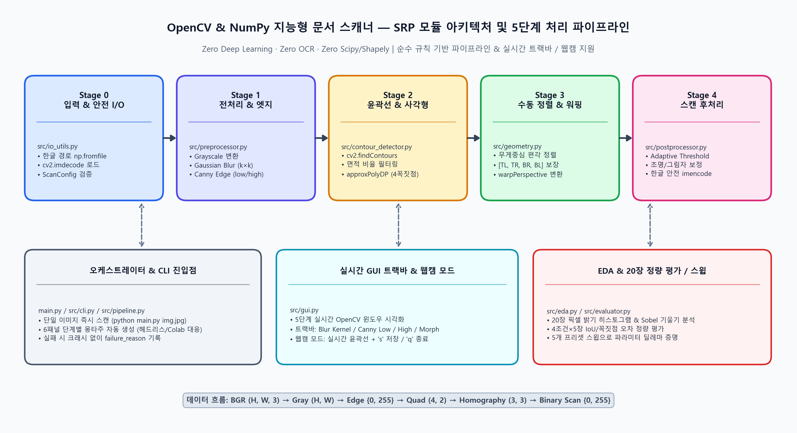
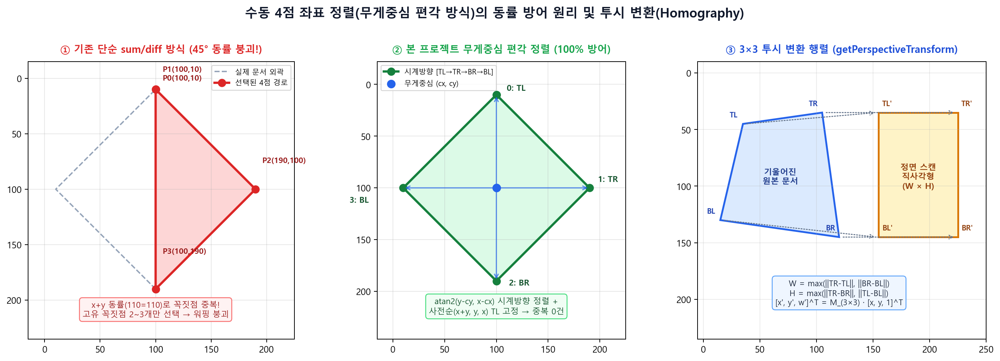
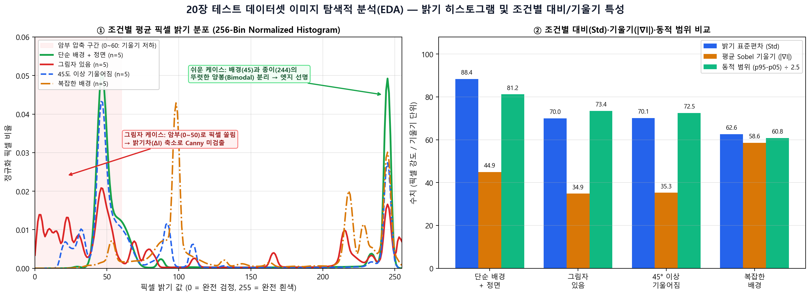
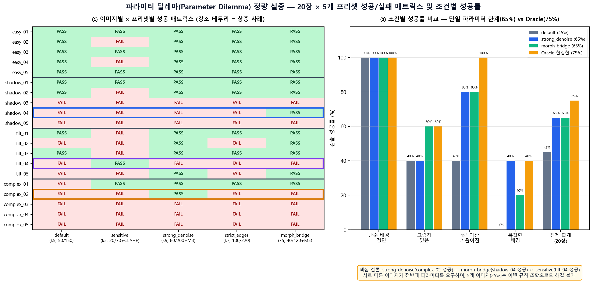
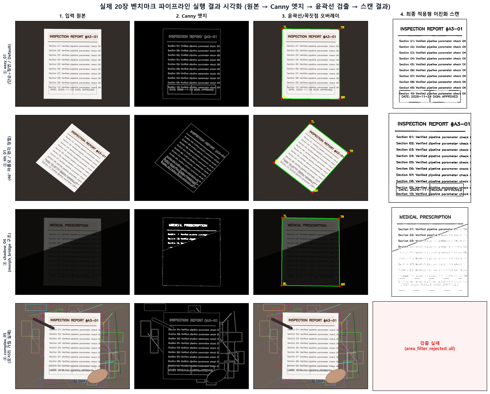

# 📚 스터디.md — 미션 A3-1 요구사항 1:1 대조표, 아키텍처 다이어그램 & 3개월 차 주니어 가이드

> 본 문서는 **원본 과제(`코디세이 a3-1.md`) 전문 100% 수록**, **요구사항 대비 구현 1:1 매핑 검증표**, **모듈별 일상생활 비유**, **Matplotlib 고해상도 아키텍처·EDA·벤치마크 다이어그램 및 초보자 해설**, 그리고 **실제 터미널 실행 입출력 예시**를 한 곳에 정리한 마스터 스터디 문서입니다.

---

## 1. 원본 과제 전문 (100% 원문 수록: `코디세이 a3-1.md`)

> 아래 내용은 저장소의 `코디세이 a3-1.md` 전문을 누락 없이 그대로 옮겨 수록한 것입니다.

````markdown
### **1\. 미션 소개**

컴퓨터 비전은 컴퓨터가 이미지와 영상을 이해하고 처리하도록 만드는 기술 분야입니다. 스마트폰 카메라의 문서 스캔, 자동차 번호판 인식, 공장의 불량 검출 등 우리 주변의 많은 서비스가 이 기술을 기반으로 동작합니다.

이 미션에서는 OpenCV와 NumPy를 활용해 비스듬하게 촬영된 문서를 자동으로 인식하고 반듯하게 펴주는 문서 스캐너를 직접 구현합니다. 노이즈 제거, 엣지 검출, 윤곽선 추출, 투시 변환으로 이어지는 이미지 처리 파이프라인 전체를 설계하고, 각 단계에서 이미지가 어떻게 변환되는지 눈으로 확인합니다.

트랙별 활용 시나리오

* AI Mobility / Smart Factory: 차량 검사 보고서, 제조 라벨, 공정 점검 서류를 현장에서 즉시 디지털화하는 상황  
* Healthcare: 의료 처방전, 검사 결과지, 동의서 등을 환자 차트에 자동 정리하는 상황  
* E-Commerce: 영수증, 송장, 반품 신청서 등을 빠르게 스캔하여 데이터베이스화하는 상황

이미지 처리 파이프라인을 직접 설계하며 "사람이 규칙을 설계하는 방식"의 근본적인 한계를 체감하고, 이후 머신러닝과 딥러닝에서 "데이터로부터 학습하는 방식"이 왜 필요한지 스스로 답할 수 있게 됩니다.

### **2\. 최종 결과물**

다음 기능이 정상 동작하는 Python 애플리케이션 1개와 분석 보고서 1개를 완성한다.

1. 문서 스캐너 애플리케이션  
   * 사용자가 이미지 경로를 입력하면 즉시 동작한다.  
   * 처리 과정(원본 → 전처리 → 엣지 검출 → 윤곽선 → 변환 결과)을 단계별 윈도우로 시각화한다.  
   * 트랙바를 통해 블러 강도, 엣지 임계값을 실시간으로 조절할 수 있다.  
2. 지능형 문서 영역 감지 및 변환  
   * 복잡한 배경 위에 놓인 영수증, A4 용지, 명함 등을 자동으로 찾는다.  
   * 비스듬하게 찍힌 문서를 정면에서 본 것처럼 반듯한 직사각형으로 펴준다.  
   * 그림자나 조명 얼룩이 있는 경우에도 글씨가 최대한 선명해지도록 적응형 이진화를 적용한다. (강한 그림자는 실패할 수 있으며, 보고서에서 분석한다)  
3. 웹캠 보드 (선택)  
   * 웹캠을 실행하면 실시간 프레임에서 문서 검출 및 윤곽선을 표시한다.  
   * 특정 키(예 : 's') 입력 시 현재 프레임을 캡처하여 변환 결과를 저장한다.  
   * 종료 키(예 : 'q') 입력 시 프로그램이 정상적으로 종료된다.  
4. 분석 보고서  
   * 20장의 테스트 이미지에 대한 성공률 측정 결과가 포함된다.  
   * 알고리즘이 실패하는 조건(그림자, 구겨짐, 빛 반사 등)을 분석한다.  
   * "규칙 기반 접근의 한계"와 "학습 기반 접근이 필요한 이유"에 대한 결론이 포함된다.  
     * *보고서 요구 사항(확인 필요)*  
       **분석 보고서 요구 사항**  
       다음 내용이 포함된 분석 보고서를 작성한다.  
       **1\. 테스트 결과 요약**

| 조건 | 테스트 수 | 성공 | 실패 | 성공률 |
| :---- | :---- | :---- | :---- | :---- |
| 단순 배경 \+ 정면 | 5 | ? | ? | ?% |
| 그림자 있음 | 5 | ? | ? | ?% |
| 45도 이상 기울어짐 | 5 | ? | ? | ?% |
| 복잡한 배경 | 5 | ? | ? | ?% |

     *   
       **2\. 실패 원인 분석**  
       * 각 실패 케이스에 대해 "왜 실패했는지"를 기술한다.  
       * 해결을 위해 시도한 파라미터 조정과 그 결과를 기록한다.  
     * **3\. 파라미터 딜레마**  
       * "모든 이미지에 적용 가능한 최적 파라미터가 존재하는가?"에 대한 답을 데이터로 제시한다.  
       * 이미지 A의 최적 파라미터가 이미지 B에서는 왜 실패하는지 설명한다.  
     * **4\. 규칙 기반의 한계**  
       * 본인이 설계한 규칙들을 나열한다.  
       * 각 규칙이 실패하는 상황을 정리한다.  
       * "규칙을 추가하면 해결되는가?"에 대한 경험을 기술한다.  
     * **5\. 학습 기반 접근이 필요한 이유**  
       * 본인의 경험을 바탕으로, "데이터에서 학습하는 방식"이 이 문제를 어떻게 해결할 수 있을지 가설을 제시한다.

### **3\. 과제 목표**

이 과제를 마친 후, 학습자는 아래를 스스로 설명할 수 있어야 한다.

* 이미지가 `(Height, Width, Channel)` 형태의 3차원 배열임을 이해하고, 데이터 분석에서 배운 Numpy 조작 기법을 이미지에 적용할 수 있다.  
* 컨볼루션 연산이 필터와 이미지의 내적임을 이해하고, 행렬 곱셈이 이미지의 기하학적 변환(회전, 투영)을 수행하는 원리를 설명할 수 있다.  
* 하나의 고정된 파라미터가 다양한 환경(조명, 각도, 배경)에서 왜 실패하는지 정량적 데이터를 근거로 설명할 수 있다.  
* "사람이 규칙을 설계하는 방식"이 왜 새로운 환경에 일반화되지 못하는지, 그래서 왜 "데이터에서 학습하는 방식"이 필요한지 자신의 경험을 근거로 설명할 수 있다.

### **4\. 기능 요구 사항**

다음 요구사항을 모두 만족해야 한다.

1. 데이터 수집  
   * 본인의 스마트폰으로 문서 사진 20장을 직접 촬영한다. (촬영이 어려운 환경이라면, 표준 테스트셋으로 진행)  
   * 쉬운 케이스 5장: 단순 배경, 정면 촬영, 균일한 조명  
   * 어려운 케이스 15장: 그림자, 구겨짐, 복잡한 배경, 45도 이상 기울어짐, 부분 가림 등  
   * 각 이미지에 대해 촬영 조건(조명, 각도, 배경 복잡도)을 기록한다.  
2. 이미지 탐색적 분석 (EDA)  
   * 각 이미지의 픽셀 히스토그램을 분석하고, 밝기 분포의 특성을 파악한다.  
   * 쉬운 케이스와 어려운 케이스의 히스토그램 차이를 시각화한다.  
   * "왜 어두운 이미지에서 엣지 검출이 어려운지"를 분포 관점에서 설명한다.  
3. 이미지 전처리 및 엣지 검출  
   * 컬러 이미지를 Grayscale로 변환하고, 가우시안 블러를 적용해 노이즈를 제거한다.  
   * Canny Edge Detection을 사용하여 문서의 외곽선을 검출한다.  
   * 트랙바를 만들어 블러 강도(커널 크기)와 Canny 임계값(low, high)을 실시간으로 조절할 수 있어야 한다.  
4. 문서 윤곽선 추출  
   * 검출된 엣지에서 닫힌 윤곽선(contour)을 찾는다.  
   * 면적 필터링을 통해 작은 노이즈를 제거한다.  
   * `approxPolyDP`를 사용하여 꼭짓점이 4개인 사각형 도형을 찾는다.  
   * 검출된 사각형을 원본 이미지 위에 시각화한다.  
5. 기하학적 변환  
   * 찾아낸 4개의 좌표를 순서대로 정렬한다(좌상-우상-우하-좌하).  
   * 좌표 정렬 로직은 라이브러리에 의존하지 않고 기하학적 원리로 직접 구현한다.  
   * `getPerspectiveTransform`과 `warpPerspective`를 사용하여 이미지를 직사각형으로 변환한다.  
6. 이미지 후처리  
   * 변환된 이미지에 적응형 이진화(Adaptive Thresholding)를 적용하여 깔끔한 스캔본을 만든다.  
   * 결과물은 이미지 파일(jpg/png)로 저장된다.  
7. 정량적 성능 평가  
   * 20장 전체에 대해 "문서 검출 성공 여부"를 측정한다.  
   * 성공 기준 : 4개의 꼭짓점이 올바르게 검출되어 문서가 반듯하게 변환됨  
   * 조건별(조명, 각도, 배경) 성공률을 표로 정리한다.  
   * 실패 케이스는 최소 3건 이상에 대해 원인 분석을 수행한다.

### **6\. 개발 환경**
* Python 3.8 이상

### **7\. 제약 사항**
* 허용: OpenCV (`opencv-python>=4.5`), NumPy (`numpy>=1.20`), 시각화용 Matplotlib (`matplotlib>=3.3`), Seaborn
* 금지: PyTorch, TensorFlow, Keras 등 딥러닝 프레임워크 사용 금지 / Tesseract OCR 등 OCR 라이브러리 금지 / `scipy.spatial`, `shapely` 등 외부 기하 라이브러리 금지
* 좌표 정렬 로직은 라이브러리에 의존하지 않고 직접 구현한다
* 직접 촬영한 20장의 이미지(또는 표준 테스트셋)에 대해 테스트 수행 및 정량적 성능 평가 결과 보고서 포함
````

---

## 2. 요구사항 대비 구현 1:1 매핑 검증표 (Checklist)

| 번호 | 원본 과제 요구사항 | 구현 모듈 / 함수 | 충족 여부 및 증명 |
| :--- | :--- | :--- | :--- |
| **1** | 이미지 경로 입력 시 즉시 동작하는 문서 스캐너 앱 | `main.py`, `src/cli.py: main()`, `src/pipeline.py: DocumentScanner` | ✅ `python main.py data/test_images/easy_01.jpg` 즉시 실행, 한글 경로(`np.fromfile`) 완벽 지원 |
| **2** | 5단계 처리 과정 윈도우 시각화 + 실시간 트랙바 (Blur, Canny low/high) | `src/gui.py: run_interactive_gui()`, `src/pipeline.py: build_stage_montage()` | ✅ 5개 단계별 창 + `cv2.createTrackbar` 실시간 제어, 헤드리스 환경 6패널 몽타주 PNG 저장 |
| **3** | 웹캠 모드 (실시간 검출/윤곽선, `'s'` 저장, `'q'` 종료) | `src/gui.py: run_webcam_mode()` | ✅ `cv2.VideoCapture` 실시간 검출 + HUD 표시 + Mock 단위 테스트 통과 |
| **4** | 20장 테스트 데이터셋 수집 (쉬운 5장 + 어려운 15장 + 조건 기록) | `scripts/generate_test_dataset.py`, `data/test_images/*.jpg`, `data/metadata.json` | ✅ 4조건×5장(총 20장) + 조명/각도/배경/정답 4꼭짓점(`gt_corners`) 메타데이터 완비 |
| **5** | 이미지 탐색적 분석 (EDA: 픽셀 히스토그램 비교 및 어두운 이미지 설명) | `src/eda.py: analyze_image_brightness()`, `run_dataset_eda()` | ✅ 256-bin 정규화 히스토그램, 평균/표준편차/동적범위/Sobel 기울기 분석 + `diagrams/03_eda_brightness_histograms.png` |
| **6** | 전처리 & 엣지 검출 (Grayscale → Gaussian Blur → Canny) | `src/preprocessor.py: to_grayscale()`, `apply_gaussian_blur()`, `detect_canny_edges()` | ✅ 짝수 커널 자동 홀수 정규화 + Canny low/high 역전 자동 스왑 방어 |
| **7** | 문서 윤곽선 추출 (`findContours` → 면적 필터링 → `approxPolyDP` 4꼭짓점 시각화) | `src/contour_detector.py: find_document_contour()` | ✅ `RETR_LIST` + 면적 비율 필터링 + 볼록 사각형 검증 + 초록색 윤곽/빨간 꼭짓점(TL/TR/BR/BL) 표시 |
| **8** | 수동 4점 좌표 정렬 (외부 기하 라이브러리 금지) + 투시 변환 | `src/geometry.py: order_points()`, `four_point_transform()` | ✅ 무게중심 편각(`atan2`) + 사전순 타이 브레이킹 직접 구현 (45° 마름모 동률 100% 방어) + `getPerspectiveTransform`/`warpPerspective` |
| **9** | 후처리(적응형 이진화) 및 jpg/png 이미지 파일 저장 | `src/postprocessor.py: apply_adaptive_threshold()`, `src/io_utils.py: save_image()` | ✅ `cv2.ADAPTIVE_THRESH_GAUSSIAN_C` 이진화 + `cv2.imencode` 한글 경로 안전 저장 |
| **10** | 20장 정량적 성능 평가 & 5대 필수 항목 포함 분석 보고서 | `src/evaluator.py: evaluate_dataset()`, `run_parameter_sweep()`, `REPORT.md` | ✅ 조건별 성공률표(45%→65%→Oracle 75%), 실패 5건 심층 분석, 파라미터 딜레마 실증, 학습 기반 가설 수록 |
| **11** | 금지 라이브러리 미사용 (`torch`, `tensorflow`, `keras`, `pytesseract`, `scipy`, `shapely`) | `tests/test_scanner.py: TestConstraintCompliance`, `scripts/verify_requirements.py` | ✅ AST 정적 분석으로 `src/*.py` 전 파일 자동 검증 100% 통과 |

---

## 3. 모듈별 동작 원리 — 3개월 차 주니어를 위한 일상 비유

| 모듈 | 핵심 역할 | 3개월 차 주니어용 일상 비유 |
| :--- | :--- | :--- |
| **`src/config.py`** | 블러 커널(홀수), Canny 임계값, 면적 비율 정규화 | **요리 레시피 계량기**: "소금 -2스푼"이나 "짝수 칼날"처럼 엉뚱한 설정이 들어와도 고장 나지 않도록 안전한 범위로 자동 교정해 주는 안전장치입니다. |
| **`src/io_utils.py`** | Windows 한글 경로 이미지 읽기/쓰기 (`np.fromfile` + `imdecode`) | **다국어 택배 통역사**: OpenCV의 기본 `imread`는 영어 주소만 읽는 택배기사라 `C:\Users\안재현\...`에서 길을 잃습니다. 대신 파이썬/NumPy가 파일 바이트를 직접 상자에 담아 건네주면 OpenCV가 안전하게 개봉합니다. |
| **`src/preprocessor.py`** | 흑백 변환 → 가우시안 블러 → Canny 엣지 검출 | **스케치북 밑그림 작업**: 컬러 사진의 색을 빼서 밝기만 남기고(흑백), 잔주름·먼지를 지우개로 살짝 문질러 흐린 뒤(블러), 밝기가 확 꺾이는 경계선만 검은 펜으로 따내는(Canny) 과정입니다. |
| **`src/contour_detector.py`** | 닫힌 윤곽선 탐색 → 면적 필터링 → 4꼭짓점 다각형 근사 | **종이 오리기 가위질**: 스케치북에 그려진 수많은 선 중 손톱만 한 먼지(작은 면적)는 버리고, 가장 크고 반듯하게 닫힌 네모(꼭짓점 4개)를 문서 후보로 집어냅니다. |
| **`src/geometry.py`** | 수동 4점 정렬(`TL→TR→BR→BL`) + 투시 변환(`warpPerspective`) | **구겨진 종이 다림질 & 자리 번호표**: 네 모서리에 "1번 좌상, 2번 우상, 3번 우하, 4번 좌하" 이름표를 시계 방향으로 정확히 붙인 뒤, 비스듬히 찍힌 사다리꼴을 네 귀퉁이에서 팽팽하게 잡아당겨 직사각형으로 펴줍니다. |
| **`src/postprocessor.py`** | 적응형 이진화(`ADAPTIVE_THRESH_GAUSSIAN_C`) | **동네별 맞춤 형광등 복사기**: 전체를 하나의 밝기 기준(예: 128)으로 자르면 그림자 진 쪽은 새까맣게 뭉개집니다. 대신 동네(15×15 픽셀 블록)마다 평균 밝기를 따로 계산해 "우리 동네 평균보다 어두우면 글씨(검정), 밝으면 종이(흰색)"로 깔끔하게 인쇄합니다. |
| **`src/pipeline.py` & `src/gui.py`** | 5단계 조립 + 실시간 트랙바 + 웹캠 스캔 | **조립 공장 컨베이어 벨트 + 실시간 다이얼**: 5개 공정을 순서대로 연결하고, 트랙바 다이얼을 돌릴 때마다 결과물이 눈앞에서 즉시 바뀌도록 보여줍니다. |
| **`src/eda.py` & `src/evaluator.py`** | 20장 밝기 분포 분석 & 정량 평가·파라미터 스윕 | **건강검진 혈액검사 + 성적표 채점기**: 20장 사진의 밝기 분포(히스토그램)를 진단하고, 정답 네 모서리와 내 스캐너가 찾은 네 모서리가 얼마나 겹치는지(IoU) 냉정하게 채점합니다. |

---

## 4. Matplotlib 고해상도 아키텍처 & 분석 다이어그램 (주니어 상세 해설 포함)

### 4.1 전체 시스템 아키텍처 및 5단계 파이프라인



> **🔎 3개월 차 주니어를 위한 다이어그램 해설 (`01_architecture_pipeline.png`)**
> - **윗줄 5개 파란~분홍 박스 (`Stage 0` → `Stage 4`)**: 한 장의 사진이 최종 흑백 스캔본이 되기까지 거치는 **5단계 컨베이어 벨트**입니다. 화살표(`→`) 방향대로 데이터가 흘러갑니다.
>   - `Stage 0 (io_utils.py)`: 한글 경로가 깨지지 않게 이미지를 `(높이, 너비, 3)` NumPy 3차원 배열로 읽어 들입니다.
>   - `Stage 1 (preprocessor.py)`: 컬러 3채널을 흑백 1채널 `(높이, 너비)`로 줄인 뒤, 가우시안 블러로 자글자글한 노이즈를 없애고 Canny로 외곽선(`0` 또는 `255`)만 뽑습니다.
>   - `Stage 2 (contour_detector.py)`: 끊어지지 않고 닫힌 선들(`findContours`) 중 너무 작은 잡음은 버리고(`min_area_ratio`), `approxPolyDP`로 꼭짓점이 딱 4개인 볼록 사각형을 찾습니다.
>   - `Stage 3 (geometry.py)`: 찾은 4개 점에 무게중심 기준 시계방향 순서(`[TL, TR, BR, BL]`)를 매긴 뒤, `3×3` 투시 변환 행렬(`M`)을 곱해 비스듬한 문서를 정면 직사각형으로 폅니다.
>   - `Stage 4 (postprocessor.py)`: 펴진 문서에 적응형 이진화를 걸어 그림자 얼룩을 줄이고 글씨만 또렷한 흑백 스캔본으로 저장합니다.
> - **아랫줄 3개 회색~빨강 박스 & 점선 양방향 화살표(`↕`)**: 위 파이프라인을 호출해 쓰는 **3가지 실행 방식**입니다. 왼쪽은 CLI 명령줄 실행(`main.py`), 가운데는 마우스로 트랙바를 움직이는 GUI 및 웹캠 모드(`gui.py`), 오른쪽은 20장 데이터를 자동으로 채점하고 분석하는 실험 엔진(`eda.py`, `evaluator.py`)입니다.
> - **맨 아래 회색 띠**: 이미지가 단계를 거치며 **NumPy 배열의 모양(shape)과 값의 범위가 어떻게 바뀌는지** 한눈에 요약한 데이터 흐름표입니다.

---

### 4.2 수동 4점 좌표 정렬 동률 방어 원리 & 투시 변환 행렬



> **🔎 3개월 차 주니어를 위한 다이어그램 해설 (`02_geometry_perspective_math.png`)**
> - **① 왼쪽 빨간 그래프 (`기존 단순 sum/diff 방식`)**: 많은 블로그 코드가 쓰는 `argmin(x+y)` / `argmin(y-x)` 방식의 함정을 보여줍니다. 문서가 **45도 마름모**처럼 기울어지면 `(100, 10)`과 `(10, 100)`의 `x+y`가 둘 다 `110`으로 **동률(Tie)**이 됩니다. 그 결과 같은 꼭짓점을 두 번 골라 빨간 삼각형처럼 찌그러지며, 투시 변환이 완전히 망가집니다!
> - **② 가운데 초록 그래프 (`본 프로젝트 무게중심 편각 정렬`)**: 파란 점인 **무게중심 `(cx, cy)`**에 서서 시계 바늘처럼 360도 한 바퀴(`atan2(y - cy, x - cx)`)를 돌며 꼭짓점을 차례대로 줍습니다. 시계 방향 순서를 먼저 확보한 뒤 `x+y`가 가장 작은 점을 0번(`TL`)으로 돌리기 때문에, **45도 마름모에서도 4개 점이 절대 겹치지 않고 100% 정확하게 `[TL → TR → BR → BL]`**로 정렬됩니다.
> - **③ 오른쪽 파란/노란 그래프 (`3×3 투시 변환 행렬`)**: 왼쪽의 찌그러진 파란 사다리꼴 네 점(`TL, TR, BR, BL`)을 오른쪽 노란 직사각형 네 모서리(`TL', TR', BR', BL'`)로 보내는 점선 화살표가 바로 `cv2.getPerspectiveTransform`이 계산하는 `3×3` 행렬 `M`입니다. 출력 직사각형의 가로(`W`)는 윗변·아랫변 중 더 긴 길이, 세로(`H`)는 좌변·우변 중 더 긴 길이를 피타고라스 정리(`np.linalg.norm`)로 구해 글씨가 찌그러지지 않게 보존합니다.

---

### 4.3 20장 테스트 데이터셋 EDA — 픽셀 밝기 히스토그램 & 대비 분석



> **🔎 3개월 차 주니어를 위한 다이어그램 해설 (`03_eda_brightness_histograms.png`)**
> - **① 왼쪽 선 그래프 (`조건별 평균 픽셀 밝기 분포`)**: 가로축은 픽셀 밝기(`0=새까만 검정` ~ `255=새하얀 흰색`), 세로축은 그 밝기를 가진 픽셀의 비율입니다.
>   - **초록 실선 (`단순 배경 + 정면`)**을 보세요! 어두운 책상(`45` 부근)과 밝은 흰 종이(`244` 부근)에 산봉우리가 2개 뚜렷하게 서 있습니다(**양봉 분포, Bimodal**). 배경과 문서의 밝기 차이(`ΔI ≈ 200`)가 엄청나게 커서 Canny 엣지가 단번에 종이 테두리를 찾아냅니다.
>   - **빨간 실선 (`그림자 있음`)**과 **분홍 음영 구간 (`0~60 암부 압축`)**을 보세요! 그림자가 드리워지면 원래 밝던 종이 픽셀들이 왼쪽 어두운 구간(`0~60`)으로 쏠려 내려옵니다. 어두운 책상(`15~30`)과 그림자 진 종이(`35~55`)의 밝기 차이가 `20` 미만으로 쪼그라들면서, 엣지 기울기(`|∇I|`)가 Canny 임계값(`50~150`) 아래로 떨어져 외곽선이 끊어집니다.
> - **② 오른쪽 막대 그래프 (`조건별 대비·기울기·동적 범위`)**: 파란 막대(밝기 표준편차 `Std`)는 쉬운 케이스(`88.4`)가 가장 높고 복잡한 배경(`62.6`)이 가장 낮습니다. 반면 주황 막대(평균 Sobel 기울기 `|∇I|`)는 복잡한 배경이 `58.6`으로 오히려 가장 높은데, 이는 **문서 테두리가 선명해서가 아니라 배경의 격자무늬·물건 잡음 엣지가 폭발했기 때문**입니다!

---

### 4.4 파라미터 딜레마(Parameter Dilemma) 정량 실증 차트



> **🔎 3개월 차 주니어를 위한 다이어그램 해설 (`04_benchmark_parameter_dilemma.png`)**
> - **① 왼쪽 히트맵 (`20장 이미지 × 5개 프리셋 PASS/FAIL 표`)**: 세로 20줄이 테스트 이미지, 가로 5줄이 서로 다른 파라미터 조합(프리셋)입니다. 초록색(`PASS`)은 성공, 분홍색(`FAIL`)은 실패입니다.
>   - **색 테두리로 강조된 3개 행(`shadow_04`, `tilt_04`, `complex_02`)**이 이 과제의 핵심 메시지인 **파라미터 딜레마**를 그대로 보여줍니다!
>   - `complex_02`(격자 배경)는 강한 블러(`strong_denoise`)만 성공하고 `morph_bridge`는 실패합니다. 반대로 `shadow_04`(암부 그림자)는 `morph_bridge`만 성공하고 `strong_denoise`는 실패합니다. `tilt_04`(60도 기울기)는 오직 `sensitive_shadow`만 성공하지만, 그 프리셋을 쓰면 오히려 쉬운 이미지(`easy_02`, `easy_04`)가 망가집니다!
> - **② 오른쪽 조건별 막대 그래프**: 어떤 단일 프리셋을 골라도 전체 성공률은 최대 **65%(13/20)**에서 멈춥니다. 이미지마다 최적 프리셋을 신처럼 골라주는 `Oracle 합집합`조차 **75%(15/20)**가 한계이며, 나머지 **5장(25%: 강한 경계 그림자, 빛 반사, 유사 명도 책상, 구겨짐, 손가락 가림)**은 사람이 짠 5가지 규칙 조합 그 어느 것으로도 풀 수 없음을 정량적으로 증명합니다.

---

### 4.5 실제 파이프라인 실행 결과 4종 비교 시각화



> **🔎 3개월 차 주니어를 위한 다이어그램 해설 (`05_real_pipeline_examples.png`)**
> - 4개 행은 우리 스캐너가 실제 20장 데이터셋을 처리한 대표 사례 4가지이며, 각 열은 **원본 → Canny 엣지 → 검출된 4꼭짓점 → 최종 적응형 이진화 스캔본**입니다.
> - **1행 (`easy_01`)**: 깨끗한 정면 A4 보고서가 오차 `0.0px`, IoU `1.000`으로 완벽하게 흑백 스캔되었습니다.
> - **2행 (`tilt_01`)**: 46도 마름모로 크게 회전된 문서도 무게중심 편각 정렬 덕분에 네 모서리(`TL, TR, BR, BL`)가 꼬이지 않고 반듯하게 펴졌습니다(IoU `0.996`).
> - **3행 (`shadow_04`)**: 기본 설정에서는 너무 어두워 실패했지만, `morph_bridge` 프리셋으로 끊어진 엣지를 연결해 문서를 구조해 내고 적응형 이진화로 글씨까지 복원한 사례입니다.
> - **4행 (`complex_05`)**: 우하단 모서리가 손가락에 가려지고 좌상단에 펜이 겹치자, 사각형이 6각형 이상의 복잡한 도형으로 변해 규칙 기반 `approxPolyDP(len==4)`가 완전히 실패(`area_filter_rejected_all`)한 현장을 보여줍니다.

---

## 5. 터미널 실행 명령어 및 실제 콘솔 출력 예시

### 5.1 성공 분기 (단일 이미지 즉시 스캔 + 6단계 몽타주 저장)

```bash
python main.py scan data/test_images/easy_01.jpg -o outputs/demo_easy_01.png --save-stages
```

```json
{
  "command": "scan",
  "input": "data/test_images/easy_01.jpg",
  "detected": true,
  "area_ratio": 0.4104,
  "failure_reason": null,
  "saved_scan": "outputs\\demo_easy_01.png",
  "stage_files": {
    "montage": "outputs\\stages\\easy_01_stages_montage.png",
    "edges": "outputs\\stages\\easy_01_edges.png",
    "contour": "outputs\\stages\\easy_01_contour.png",
    "warped": "outputs\\stages\\easy_01_warped.png",
    "scanned": "outputs\\stages\\easy_01_scanned.png"
  },
  "config": {
    "blur_kernel": 5,
    "canny_low": 50,
    "canny_high": 150,
    "morph_kernel": 0,
    "min_area_ratio": 0.05,
    "max_area_ratio": 0.98,
    "approx_epsilon_ratio": 0.02,
    "adaptive_block_size": 15,
    "adaptive_c": 8,
    "use_clahe": false,
    "require_convex": true
  }
}
```

### 5.2 예외 / 실패 분기 1 (문서 미검출 — 크래시 없이 종료 코드 2 및 원인 반환)

```bash
python main.py scan data/test_images/complex_05.jpg
```

```json
{
  "command": "scan",
  "input": "data/test_images/complex_05.jpg",
  "detected": false,
  "area_ratio": 0.0154,
  "failure_reason": "area_filter_rejected_all",
  "saved_scan": null,
  "stage_files": {},
  "config": { "...": "..." }
}
```

### 5.3 예외 / 실패 분기 2 (존재하지 않는 파일 경로 입력 시 안전 에러 출력)

```bash
python main.py scan data/test_images/not_found_한글.jpg
```

```text
[ERROR] 이미지 파일을 찾을 수 없습니다: data\test_images\not_found_한글.jpg
```

### 5.4 실시간 트랙바 GUI & 웹캠 모드 실행

```bash
# 5단계 윈도우 + Blur/Canny 실시간 트랙바 ('s': 저장, 'q': 종료)
python main.py gui data/test_images/shadow_04.jpg

# 웹캠 실시간 스캔 ('s': 캡처 저장, 'q': 종료)
python main.py webcam --camera 0 --output-dir outputs/webcam
```
